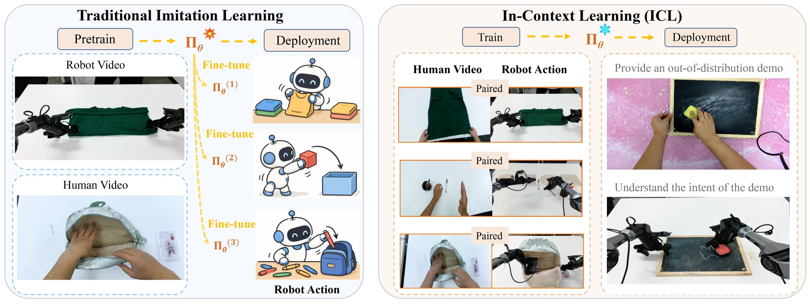
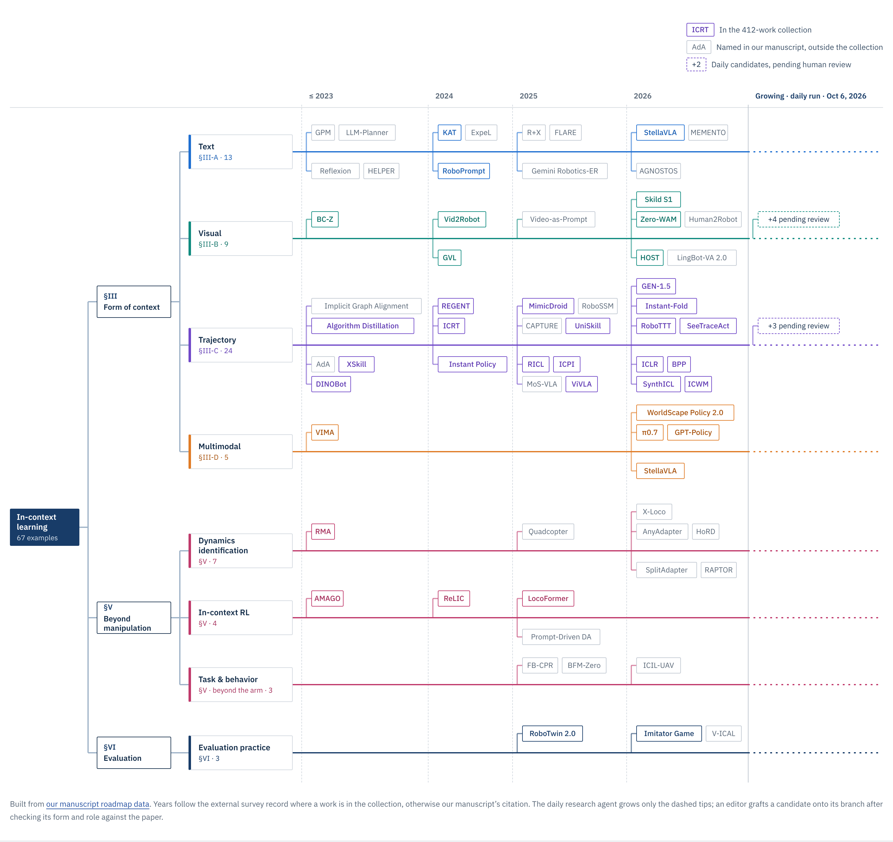
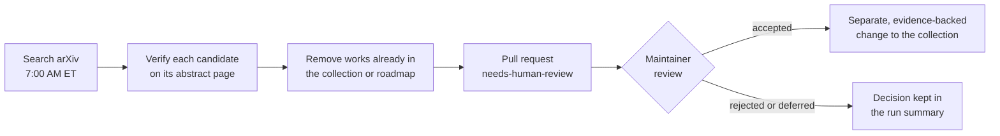
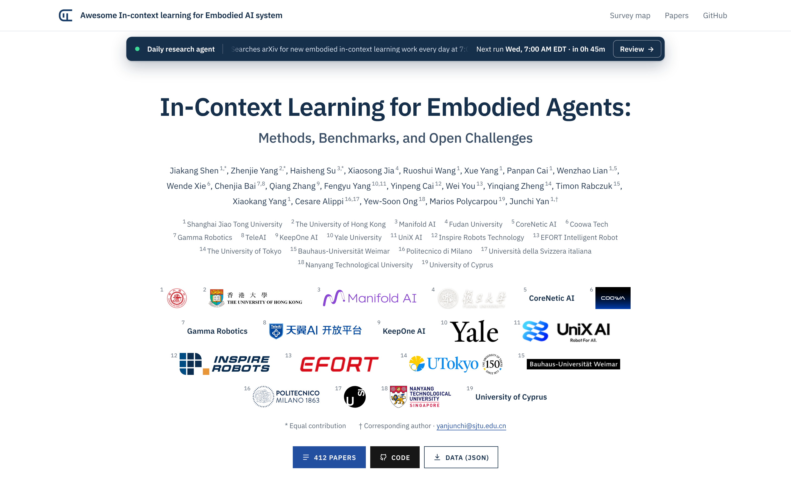

<!-- github-only:start -->
<p align="center">
  <a href="https://wangevan6.github.io/Awesome-Embodied-ICL/"><picture><source media="(prefers-color-scheme: dark)" srcset="assets/readme/banner-dark.svg"></picture></a>
</p>
<!-- github-only:end -->

# Awesome In-context learning for Embodied AI system

<!-- github-only:start -->
<p align="center">
<!-- BADGES:START -->
<a href="https://github.com/sindresorhus/awesome"></a>
<a href="#paper-list"></a>
<a href="#survey-map"></a>
<a href="#daily-research-agent"></a>
<a href="https://github.com/wangevan6/Awesome-Embodied-ICL/issues/new?template=paper.yml"></a>
<!-- BADGES:END -->
</p>

<p align="center">
  <b>The companion repository to our survey</b><br>
  <i>In-Context Learning for Embodied Agents: Methods, Benchmarks, and Open Challenges</i>
</p>

<p align="center">
  Jiakang Shen<sup>1,*</sup>, Zhenjie Yang<sup>2,*</sup>, Haisheng Su<sup>3,*</sup>, Xiaosong Jia<sup>4</sup>, Ruoshui Wang<sup>1</sup>, Xue Yang<sup>1</sup>, Panpan Cai<sup>1</sup>, Wenzhao Lian<sup>1,5</sup>, Wende Xie<sup>6</sup>, Chenjia Bai<sup>7,8</sup>, Qiang Zhang<sup>9</sup>, Fengyu Yang<sup>10,11</sup>, Yinpeng Cai<sup>12</sup>, Wei You<sup>13</sup>, Yinqiang Zheng<sup>14</sup>, Timon Rabczuk<sup>15</sup>, Xiaokang Yang<sup>1</sup>, Cesare Alippi<sup>16,17</sup>, Yew-Soon Ong<sup>18</sup>, Marios Polycarpou<sup>19</sup>, Junchi Yan<sup>1,†</sup>
</p>

<p align="center"><sub>
  <sup>1</sup>Shanghai Jiao Tong University · <sup>2</sup>The University of Hong Kong · <sup>3</sup>Manifold AI · <sup>4</sup>Fudan University · <sup>5</sup>CoreNetic AI · <sup>6</sup>Coowa Tech · <sup>7</sup>Gamma Robotics · <sup>8</sup>TeleAI · <sup>9</sup>KeepOne AI · <sup>10</sup>Yale University · <sup>11</sup>UniX AI · <sup>12</sup>Inspire Robots Technology · <sup>13</sup>EFORT Intelligent Robot · <sup>14</sup>The University of Tokyo · <sup>15</sup>Bauhaus-Universität Weimar · <sup>16</sup>Politecnico di Milano · <sup>17</sup>Università della Svizzera italiana · <sup>18</sup>Nanyang Technological University · <sup>19</sup>University of Cyprus<br>
  * Equal contribution · † Corresponding author
</sub></p>

<p align="center">
  <a href="https://wangevan6.github.io/Awesome-Embodied-ICL/"><b>Website</b></a> ·
  <a href="#survey-map"><b>Survey map</b></a> ·
  <a href="#paper-list"><b>Paper list</b></a> ·
  <a href="#daily-research-agent"><b>Daily agent</b></a> ·
  <a href="#contributing"><b>Contribute</b></a> ·
  <a href="#citation"><b>Cite</b></a>
</p>
<!-- github-only:end -->

Can a robot take on a new task from context alone (a demonstration, an instruction, a video, or its own experience) while its policy weights stay fixed? This repository collects the research on that question and organizes it with the framework of our survey. Every work is read on two axes: the **form** of the context it receives and the **role** that context plays at deployment.

## News

- **Oct 2026** · The daily research agent proposes newly posted arXiv work every morning as a pull request for human review. See [how it works](#daily-research-agent).
- **Oct 2026** · Launch of the website, the survey map, and the 412-work collection organized by our manuscript’s framework.

## At a glance

<!-- STATS:START -->
| **412** | **67** | **38** | **29** | **21** | **23** |
| --- | --- | --- | --- | --- | --- |
| works in the collection | examples in our manuscript’s roadmap | roadmap examples in the collection | roadmap examples outside it | works with reading notes | daily candidates awaiting review |
<!-- STATS:END -->

## Abstract

Embodied in-context learning (Embodied-ICL) studies whether a robot can adapt at deployment by conditioning on test-time context while keeping its policy weights fixed. Unlike the standard imitation learning paradigm that relies on finetuning for new tasks, these methods treat context, e.g. language, images or video, demonstrations, and retrieved experience, as a behavioral interface that can specify what to do, disambiguate state, or directly convey a new action mapping. This survey proposes an operational definition that separates true context-driven adaptation from mere additional inputs, then organizes recent systems along two axes: the form of context, and a threefold taxonomy of the role context plays at deployment — specifying the task, representing state, or specifying behavior — and extends this taxonomy beyond arm manipulation to legged and humanoid locomotion, navigation, aerial control, and driving. We summarize evaluation practice, recurring failure modes, and open challenges in cross-task generalization and protocols that separate context-driven adaptation from fixed-policy execution.

<!-- github-only:start -->
<p align="center"></p>
<!-- github-only:end -->

**Figure 1.** Standard imitation learning versus Embodied-ICL. Left: a policy is pretrained on large, diverse corpora of robot and human video, then fine-tuned separately for each downstream task. Right: training pairs a context example with the corresponding robot action, so at deployment the frozen policy produces an executable action sequence from the context example alone, without test-time fine-tuning. (Our manuscript, p. 3.)

## Framework

Our manuscript asks two questions of every method: what form the evidence takes, and what it changes at deployment. The axes are independent. One form can serve several roles, and one role can use different forms.

**Form of context.** What does the agent receive? (§III)

| Form | What the agent receives | Examples |
| --- | --- | --- |
| **Text** | Instructions, structured descriptions, and verbal feedback | KAT · RoboPrompt · StellaVLA |
| **Visual** | Images and video of goals, demonstrated actions, or visual progress | BC-Z · Vid2Robot · Zero-WAM |
| **Trajectory** | Sequences of observations, actions, and interaction outcomes | ICRT · Instant Policy · BPP · RoboSSM |
| **Multimodal** | Language, vision, and demonstrations combined | VIMA · π0.7 · GPT-Policy |

**Role at deployment.** What does that evidence specify? (§IV-A)

| Role | What the context specifies | Examples |
| --- | --- | --- |
| **Task specification** | What to do: the intended goal or task for an already capable policy | Zero-WAM · HOST · π0.7 |
| **State representation** | What is happening: hidden state, dynamics, or task progress | CAPTURE · ICWM · GVL |
| **Behavior specification** | How to act: an action mapping or execution pattern inferred from examples | ICRT · Instant Policy · RICL |

Two further distinctions are recorded alongside both axes. **Self-built context** (§IV-B) is evidence the agent constructs from its own interactions, feedback, and reflections, as in Reflexion, ExpeL, and MEMENTO. **Gradients at deployment** (§IV-C) separate *gradient-free* conditioning, *update-optional* methods that may add adaptation steps, and *update-dependent* methods that require them, as in RICL, BPP, and RoboTTT.

The survey then extends the taxonomy **beyond manipulation** to legged and humanoid locomotion, navigation, aerial control, and driving (§V); reviews **evaluation** through graded novelty, cross-task evaluation, and diagnostics with wrong or missing context (§VI); and closes with **six open problems** (§VII): where in-context ability comes from, which training diversity transfers, how to move beyond trajectory imitation, how to select and compress context, how context and optional gradients interact, and how evaluation reaches beyond arm manipulation.

## Survey map

The survey map turns our manuscript’s roadmap into a tree. Branches follow its sections, sub-branches its subsections, and each leaf is a roadmap example placed by year. Dashed tips count daily candidates still awaiting review; they join a branch only after an editor checks their form and role against the paper.

<!-- github-only:start -->
<p align="center"><a href="https://wangevan6.github.io/Awesome-Embodied-ICL/#survey-map"></a></p>
<p align="center"><sub>Snapshot from the website. The interactive map filters the paper library by branch and opens each work.</sub></p>
<!-- github-only:end -->

## Paper list

<!-- FEATURED:START -->
Every example our manuscript’s roadmap assigns, grouped like the survey map and newest first. Labels show the role at deployment, self-built context, and deployment updates only where our manuscript assigns them. Works outside the 412-work collection are named by our manuscript, with the arXiv identifier its bibliography cites when it gives one.

### Text context · §III-A

13 roadmap examples · 3 in the collection

| Work | Year | Our manuscript’s labels | Links |
| --- | --- | --- | --- |
| **AGNOSTOS** | 2026 | — | Our ref. [25] |
| **MEMENTO** | 2026 | Self-built context | Our ref. [24] |
| **StellaVLA** — In-Context Structured Demonstration for Generalizable Vision-Language-Action Models | 2026 | — | [Paper](https://arxiv.org/abs/2608.11671) · [Catalogue](CATALOGUE.md#ref-163) |
| **FLARE** | 2025 | Self-built context | Our ref. [22] |
| **Gemini Robotics-ER** | 2025 | — | [arXiv](https://arxiv.org/abs/2503.20020) · Our ref. [23] |
| **R+X** | 2025 | — | Our ref. [19] |
| **ExpeL** | 2024 | Self-built context · Gradient-free | Our ref. [15] |
| **KAT** — Keypoint Action Tokens Enable In-Context Imitation Learning in Robotics | 2024 | — | [Paper](https://arxiv.org/abs/2403.19578) · [Catalogue](CATALOGUE.md#kat-2024) |
| **RoboPrompt** — In-Context Learning Enables Robot Action Prediction in LLMs | 2024 | — | [Paper](https://arxiv.org/abs/2410.12782) · [Catalogue](CATALOGUE.md#roboprompt-2024) |
| **GPM** | 2023 | Behavior specification · Self-built context | [arXiv](https://arxiv.org/abs/2307.04721) · Our ref. [14] |
| **HELPER** | 2023 | Self-built context | Our ref. [18] |
| **LLM-Planner** | 2023 | Self-built context | Our ref. [16] |
| **Reflexion** | 2023 | Self-built context · Gradient-free | Our ref. [17] |

### Visual context · §III-B

9 roadmap examples · 6 in the collection

| Work | Year | Our manuscript’s labels | Links |
| --- | --- | --- | --- |
| **HOST** — Robots Acquire Manipulation Skills in Seconds from a Single Human Video | 2026 | Task specification | [Paper](https://arxiv.org/abs/2607.20033) · [Catalogue](CATALOGUE.md#ref-23) |
| **Human2Robot** | 2026 | — | Our ref. [29] |
| **LingBot-VA 2.0** | 2026 | — | [arXiv](https://arxiv.org/abs/2607.08639) · Our ref. [32] |
| **Skild S1** — Introducing S1: In-Context Learning for Robotics | 2026 | — | [Paper](https://www.skild.ai/blogs/s1) · [Catalogue](CATALOGUE.md#ref-99) |
| **Zero-WAM** — In-Context World-Action Modeling from Human Videos for Open-Ended Task Generalization | 2026 | Task specification | [Paper](https://arxiv.org/abs/2608.26103) · [Catalogue](CATALOGUE.md#zero-wam-2026) |
| **Video-as-Prompt** | 2025 | — | [arXiv](https://arxiv.org/abs/2505.20795) · Our ref. [30] |
| **GVL** — Vision Language Models are In-Context Value Learners | 2024 | State representation | [Paper](https://arxiv.org/abs/2411.04549) · [Catalogue](CATALOGUE.md#ref-83) |
| **Vid2Robot** — End-to-end Video-conditioned Policy Learning with Cross-Attention Transformers | 2024 | — | [Paper](https://arxiv.org/abs/2403.12943) · [Catalogue](CATALOGUE.md#ref-14) |
| **BC-Z** — Zero-Shot Task Generalization with Robotic Imitation Learning | 2022 | — | [Paper](https://arxiv.org/abs/2202.02005) · [Catalogue](CATALOGUE.md#ref-148) |

### Trajectory context · §III-C

24 roadmap examples · 19 in the collection

| Work | Year | Our manuscript’s labels | Links |
| --- | --- | --- | --- |
| **BPP** — Behavior Prompting Policy: Demonstrations as Prompts for Manipulation | 2026 | Update-optional | [Paper](https://arxiv.org/abs/2606.30457) · [Catalogue](CATALOGUE.md#bpp-2026) |
| **GEN-1.5** — Embodied Foundation Models are One-Shot Learners | 2026 | — | [Paper](https://generalistai.com/blog/gen-1.5) · [Catalogue](CATALOGUE.md#ref-98) |
| **ICLR** — In-Context Imitation Learning with Visual Reasoning | 2026 | — | [Paper](https://arxiv.org/abs/2603.07530) · [Catalogue](CATALOGUE.md#iclr-visual-reasoning-2026) |
| **ICWM** — In-Context World Modeling for Robotic Control | 2026 | State representation · Gradient-free | [Paper](https://arxiv.org/abs/2606.26025) · [Catalogue](CATALOGUE.md#icwm-2026) |
| **Instant-Fold** — In-Context Imitation Learning for Deformable Object Manipulation | 2026 | Behavior specification | [Paper](https://arxiv.org/abs/2606.04269) · [Catalogue](CATALOGUE.md#ref-91) |
| **RoboTTT** — Context Scaling for Robot Policies | 2026 | Update-dependent | [Paper](https://arxiv.org/abs/2607.15275) · [Catalogue](CATALOGUE.md#ref-10) |
| **SeeTraceAct** — Visibility-Aware Latent Planning from Cross-Embodiment Demonstration Videos | 2026 | — | [Paper](https://arxiv.org/abs/2606.02745) · [Catalogue](CATALOGUE.md#ref-182) |
| **SynthICL** — Scalable In-context Imitation Learning with Synthetic Data | 2026 | — | [Paper](https://arxiv.org/abs/2606.08154) · [Catalogue](CATALOGUE.md#ref-77) |
| **CAPTURE** | 2025 | State representation · Gradient-free | Our ref. [38] |
| **ICPI** — In-Context Iterative Policy Improvement for Dynamic Manipulation | 2025 | Behavior specification | [Paper](https://proceedings.mlr.press/v305/merwe25a.html) · [Catalogue](CATALOGUE.md#ref-9) |
| **MimicDroid** — In-Context Learning for Humanoid Robot Manipulation from Human Play Videos | 2025 | Behavior specification | [Paper](https://arxiv.org/abs/2509.09769) · [Catalogue](CATALOGUE.md#ref-245) |
| **MoS-VLA** | 2025 | Behavior specification | [arXiv](https://arxiv.org/abs/2510.16617) · Our ref. [45] |
| **RICL** — Adding In-Context Adaptability to Pre-Trained Vision-Language-Action Models | 2025 | Behavior specification · Gradient-free · Update-optional | [Paper](https://arxiv.org/abs/2508.02062) · [Catalogue](CATALOGUE.md#ricl-2025) |
| **RoboSSM** | 2025 | — | [arXiv](https://arxiv.org/abs/2509.19658) · Our ref. [44] |
| **UniSkill** — Imitating Human Videos via Cross-Embodiment Skill Representations | 2025 | Behavior specification | [Paper](https://arxiv.org/abs/2505.08787) · [Catalogue](CATALOGUE.md#ref-30) |
| **ViVLA** — See Once, Then Act: Vision-Language-Action Model with Task Learning from One-Shot Video Demonstrations | 2025 | — | [Paper](https://arxiv.org/abs/2512.07582) · [Catalogue](CATALOGUE.md#ref-159) |
| **ICRT** — In-Context Imitation Learning via Next-Token Prediction | 2024 | Behavior specification · Gradient-free | [Paper](https://arxiv.org/abs/2408.15980) · [Catalogue](CATALOGUE.md#icrt-2024) |
| **Instant Policy** — In-Context Imitation Learning via Graph Diffusion | 2024 | Behavior specification · Gradient-free | [Paper](https://arxiv.org/abs/2411.12633) · [Catalogue](CATALOGUE.md#instant-policy-2024) |
| **REGENT** — A Retrieval-Augmented Generalist Agent That Can Act In-Context in New Environments | 2024 | Behavior specification | [Paper](https://arxiv.org/abs/2412.04759) · [Catalogue](CATALOGUE.md#regent-2024) |
| **AdA** | 2023 | Behavior specification | [arXiv](https://arxiv.org/abs/2301.07608) · Our ref. [34] |
| **DINOBot** — Robot Manipulation via Retrieval and Alignment with Vision Foundation Models | 2023 | Behavior specification | [Paper](https://arxiv.org/abs/2402.13181) · [Catalogue](CATALOGUE.md#ref-34) |
| **Implicit Graph Alignment** | 2023 | Behavior specification | [arXiv](https://arxiv.org/abs/2310.12238) · Our ref. [36] |
| **XSkill** — Cross Embodiment Skill Discovery | 2023 | Behavior specification | [Paper](https://proceedings.mlr.press/v229/xu23a.html) · [Catalogue](CATALOGUE.md#ref-29) |
| **Algorithm Distillation** — In-context Reinforcement Learning with Algorithm Distillation | 2022 | Behavior specification | [Paper](https://arxiv.org/abs/2210.14215) · [Catalogue](CATALOGUE.md#ref-6) |

### Multimodal context · §III-D

5 roadmap examples · 5 in the collection

| Work | Year | Our manuscript’s labels | Links |
| --- | --- | --- | --- |
| **GPT-Policy** — In-context robot learning with vlm agents | 2026 | Gradient-free | [Paper](https://arxiv.org/abs/2609.19138) · [Catalogue](CATALOGUE.md#ref-94) |
| **StellaVLA** — In-Context Structured Demonstration for Generalizable Vision-Language-Action Models | 2026 | — | [Paper](https://arxiv.org/abs/2608.11671) · [Catalogue](CATALOGUE.md#ref-163) |
| **WorldScape Policy 2.0** — Empowering Steerable World Action Modeling with Reasoning-Augmented Memory | 2026 | — | [Paper](https://arxiv.org/abs/2607.18840) · [Catalogue](CATALOGUE.md#ref-25) |
| **π0.7** — a Steerable Generalist Robotic Foundation Model with Emergent Capabilities | 2026 | Task specification · Gradient-free | [Paper](https://arxiv.org/abs/2604.15483) · [Catalogue](CATALOGUE.md#ref-281) |
| **VIMA** — General Robot Manipulation with Multimodal Prompts | 2022 | — | [Paper](https://arxiv.org/abs/2210.03094) · [Catalogue](CATALOGUE.md#vima-2022) |

### Beyond manipulation · §V

14 roadmap examples · 4 in the collection

| Work | Year | Area | Our manuscript’s labels | Links |
| --- | --- | --- | --- | --- |
| **AnyAdapter** | 2026 | Dynamics identification | — | [arXiv](https://arxiv.org/abs/2509.13833) · Our ref. [58] |
| **HoRD** | 2026 | Dynamics identification | — | [arXiv](https://arxiv.org/abs/2602.04412) · Our ref. [59] |
| **ICIL-UAV** | 2026 | Task and behavior beyond the arm | — | Our ref. [70] |
| **RAPTOR** | 2026 | Dynamics identification | — | [arXiv](https://arxiv.org/abs/2509.11481) · Our ref. [62] |
| **SplitAdapter** | 2026 | Dynamics identification | — | [arXiv](https://arxiv.org/abs/2606.03297) · Our ref. [60] |
| **X-Loco** | 2026 | Dynamics identification | — | Our ref. [63] |
| **BFM-Zero** | 2025 | Task and behavior beyond the arm | — | [arXiv](https://arxiv.org/abs/2511.04131) · Our ref. [69] |
| **FB-CPR** | 2025 | Task and behavior beyond the arm | — | Our ref. [68] |
| **LocoFormer** — Generalist Locomotion via Long-context Adaptation | 2025 | In-context RL | — | [Paper](https://arxiv.org/abs/2509.23745) · [Catalogue](CATALOGUE.md#ref-40) |
| **Prompt-Driven DA** | 2025 | In-context RL | — | [arXiv](https://arxiv.org/abs/2511.12755) · Our ref. [67] |
| **Quadcopter** | 2025 | Dynamics identification | — | Our ref. [61] |
| **ReLIC** — A Recipe for 64k Steps of In-Context Reinforcement Learning for Embodied AI | 2024 | In-context RL | — | [Paper](https://arxiv.org/abs/2410.02751) · [Catalogue](CATALOGUE.md#relic-2024) |
| **AMAGO** — Scalable In-Context Reinforcement Learning for Adaptive Agents | 2023 | In-context RL | — | [Paper](https://arxiv.org/abs/2310.09971) · [Catalogue](CATALOGUE.md#amago-2023) |
| **RMA** — Rapid Motor Adaptation for Legged Robots | 2021 | Dynamics identification | — | [Paper](https://arxiv.org/abs/2107.04034) · [Catalogue](CATALOGUE.md#ref-39) |

### Evaluation · §VI

3 roadmap examples · 2 in the collection

| Work | Year | Our manuscript’s labels | Links |
| --- | --- | --- | --- |
| **Imitator Game** — The Imitator Game: Benchmarking Robot Imitative Ability Beyond Action Prediction | 2026 | Task specification | [Paper](https://arxiv.org/abs/2608.22301) · [Catalogue](CATALOGUE.md#ref-101) |
| **V-ICAL** | 2026 | — | [arXiv](https://arxiv.org/abs/2609.15683) · Our ref. [72] |
| **RoboTwin 2.0** — A scalable data generator and benchmark with strong domain randomization for robust bimanual robotic manipulation | 2025 | — | [Paper](https://arxiv.org/abs/2506.18088) · [Catalogue](CATALOGUE.md#ref-230) |
<!-- FEATURED:END -->

### All 412 works

The full collection preserves every reference of the external inventory with its original reference number, newest first. Each row links to the [annotated catalogue](CATALOGUE.md), which keeps citations, original classifications, and bibliography pages. The inventory includes methods, datasets, benchmarks, foundations, and parameter-adaptation comparisons, so membership alone does not establish fixed-weight in-context learning. Context budgets reported by the external survey are in [PROTOCOLS.md](PROTOCOLS.md).

<!-- github-only:start -->
<details>
<summary><b>Show the complete index of 412 works</b></summary>
<!-- github-only:end -->

<!-- PAPERS:START -->
| External ref. | Year | Reference | Our context form / role | Reading note |
| --- | --- | --- | --- | --- |
| [10] | 2026 | [RoboTTT: Context Scaling for Robot Policies](CATALOGUE.md#ref-10) | Trajectory | Bibliography only |
| [11] | 2026 | [WAM-TTT: Steering World-Action Models by Watching Human Play at Test Time](CATALOGUE.md#ref-11) | Mapping pending | Bibliography only |
| [18] | 2026 | [ICI-VLA: In-Context Imitation with Spatiotemporally Aligned Demonstrations for Vision-Language-Action Models](CATALOGUE.md#ici-vla-2026) | Mapping pending | Available |
| [22] | 2026 | [Demo-JEPA: Joint-Embedding Predictive Architecture for One-shot Cross-Embodiment Imitation](CATALOGUE.md#ref-22) | Mapping pending | Bibliography only |
| [23] | 2026 | [HOST: Robots Acquire Manipulation Skills in Seconds from a Single Human Video](CATALOGUE.md#ref-23) | Visual / Task specification | Bibliography only |
| [24] | 2026 | [Zero-WAM: In-Context World-Action Modeling from Human Videos for Open-Ended Task Generalization](CATALOGUE.md#zero-wam-2026) | Visual / Task specification | Available |
| [25] | 2026 | [WorldScape Policy 2.0: Empowering Steerable World Action Modeling with Reasoning-Augmented Memory](CATALOGUE.md#ref-25) | Multimodal | Bibliography only |
| [31] | 2026 | [Show-Harness: Just a VLM Agent Can Play Robots](CATALOGUE.md#ref-31) | Mapping pending | Bibliography only |
| [38] | 2026 | [SemAnCorr: Semantic Anchored Correspondence for Zero-Shot Manipulation Skill Transfer](CATALOGUE.md#ref-38) | Mapping pending | Bibliography only |
| [41] | 2026 | [In-Context World Modeling for Robotic Control](CATALOGUE.md#icwm-2026) | Trajectory / State representation | Available |
| [44] | 2026 | [MEM: Multi-Scale Embodied Memory for Vision Language Action Models](CATALOGUE.md#ref-44) | Mapping pending | Bibliography only |
| [45] | 2026 | [SimpleMemVLA: A Simple but Effective Native-Video Memory for Vision-Language-Action Models](CATALOGUE.md#ref-45) | Mapping pending | Bibliography only |
| [47] | 2026 | [ASPIRE: Agentic /Skills Discovery for Robotics](CATALOGUE.md#ref-47) | Mapping pending | Bibliography only |
| [48] | 2026 | [A Few Words Go a Long Way: Language Guided Robot Policy Synthesis](CATALOGUE.md#ref-48) | Mapping pending | Bibliography only |
| [49] | 2026 | [Self-Evolving Embodied Agents via Skill-Harness Evolution](CATALOGUE.md#ref-49) | Mapping pending | Bibliography only |
| [52] | 2026 | [Playful Agentic Robot Learning](CATALOGUE.md#ref-52) | Mapping pending | Bibliography only |
| [53] | 2026 | [Teach and Grow: An Agent-Centered Architecture for General Robot Learning](CATALOGUE.md#ref-53) | Mapping pending | Bibliography only |
| [54] | 2026 | [Behavior Prompting Policy: Demonstrations as Prompts for Manipulation](CATALOGUE.md#bpp-2026) | Trajectory | Available |
| [55] | 2026 | [ContextFlow: In-Context Flow Matching for Robot Manipulation](CATALOGUE.md#ref-55) | Mapping pending | Bibliography only |
| [66] | 2026 | [YUBI: Yielding Universal Bidigital Interface for Bimanual Dexterous Manipulation at Scale](CATALOGUE.md#ref-66) | Mapping pending | Bibliography only |
| [67] | 2026 | [EgoScale: Scaling Dexterous Manipulation with Diverse Egocentric Human Data](CATALOGUE.md#ref-67) | Mapping pending | Bibliography only |
| [77] | 2026 | [SynthICL: Scalable In-context Imitation Learning with Synthetic Data](CATALOGUE.md#ref-77) | Trajectory | Bibliography only |
| [88] | 2026 | [Zeva: In-Context Causal Learning for Generalizable Embodied Manipulation](CATALOGUE.md#zeva-2026) | Mapping pending | Available |
| [89] | 2026 | [ENPIRE: Agentic Robot Policy Self-Improvement in the Real World](CATALOGUE.md#ref-89) | Mapping pending | Bibliography only |
| [90] | 2026 | [Zetta ζ: An Efficient Closed-Loop Embodied Harness for Self-Evolving Physical Intelligence](CATALOGUE.md#ref-90) | Mapping pending | Bibliography only |
| [91] | 2026 | [Instant-Fold: In-Context Imitation Learning for Deformable Object Manipulation](CATALOGUE.md#ref-91) | Trajectory / Behavior specification | Bibliography only |
| [92] | 2026 | [Bimanual Robot Manipulation via Multi-Agent In-Context Learning](CATALOGUE.md#bicicle-2026) | Mapping pending | Available |
| [94] | 2026 | [In-context robot learning with vlm agents](CATALOGUE.md#ref-94) | Multimodal | Bibliography only |
| [95] | 2026 | [LabDex: A Hierarchical Benchmark for Dexterous Manipulation in Laboratories](CATALOGUE.md#ref-95) | Mapping pending | Bibliography only |
| [97] | 2026 | [AdaTracker: Learning Adaptive In-Context Policy for Cross-Embodiment Active Visual Tracking](CATALOGUE.md#ref-97) | Mapping pending | Bibliography only |
| [98] | 2026 | [GEN-1.5: Embodied Foundation Models are One-Shot Learners](CATALOGUE.md#ref-98) | Trajectory | Bibliography only |
| [99] | 2026 | [Introducing S1: In-Context Learning for Robotics](CATALOGUE.md#ref-99) | Visual | Bibliography only |
| [101] | 2026 | [The Imitator Game: Benchmarking Robot Imitative Ability Beyond Action Prediction](CATALOGUE.md#ref-101) | Task specification | Bibliography only |
| [103] | 2026 | [RoboMME: Benchmarking and understanding memory for robotic generalist policies](CATALOGUE.md#ref-103) | Mapping pending | Bibliography only |
| [104] | 2026 | [MEMOBench: A Process Level Memory Benchmark for Robotic Manipulation](CATALOGUE.md#ref-104) | Mapping pending | Bibliography only |
| [105] | 2026 | [Gated Memory Policy: In-Context Memorization and Adaptation](CATALOGUE.md#ref-105) | Mapping pending | Bibliography only |
| [107] | 2026 | [When Vision Overrides Language: Evaluating and Mitigating Counterfactual Failures in VLAs](CATALOGUE.md#ref-107) | Mapping pending | Bibliography only |
| [108] | 2026 | [ReSteer: Quantifying and Refining the Steerability of Multitask Robot Policies](CATALOGUE.md#ref-108) | Mapping pending | Bibliography only |
| [109] | 2026 | [RoboSemanticBench: Diagnosing Semantic Grounding in Action Prediction for VLA Models](CATALOGUE.md#ref-109) | Mapping pending | Bibliography only |
| [110] | 2026 | [Behavior-Skill: A Fine-Grained Benchmark for Evaluating Vision-Language-Action Policies in Long-Horizon Tasks](CATALOGUE.md#ref-110) | Mapping pending | Bibliography only |
| [126] | 2026 | [Robot Learning from Human Videos: A Survey](CATALOGUE.md#ref-126) | Mapping pending | Bibliography only |
| [127] | 2026 | [In-Context Reinforcement Learning under Non-Stationarity: A Survey](CATALOGUE.md#ref-127) | Mapping pending | Bibliography only |
| [128] | 2026 | [World Model for Robot Learning: A Comprehensive Survey](CATALOGUE.md#ref-128) | Mapping pending | Bibliography only |
| [129] | 2026 | [Vision-Language-Action in Robotics: A Survey of Datasets, Benchmarks, and Data Engines](CATALOGUE.md#ref-129) | Mapping pending | Bibliography only |
| [130] | 2026 | [The Embodiment Gap in Robot Foundation Models](CATALOGUE.md#ref-130) | Mapping pending | Bibliography only |
| [133] | 2026 | [Demonstrate once, execute on many: Kinematic intelligence for cross-robot skill transfer](CATALOGUE.md#ref-133) | Mapping pending | Bibliography only |
| [142] | 2026 | [Training-Free Action Correction for VLA Model Failures via Language Feedback](CATALOGUE.md#ref-142) | Mapping pending | Bibliography only |
| [152] | 2026 | [Retrieve, Don’t Retrain: Extending Vision Language Action Models to New Tasks at Test Time](CATALOGUE.md#ref-152) | Mapping pending | Bibliography only |
| [160] | 2026 | [Mimic Intent, Not Just Trajectories](CATALOGUE.md#ref-160) | Mapping pending | Bibliography only |
| [161] | 2026 | [MatchingPolicy: Correspondence-Aware Policy Enables Cross-Object In-Context Learning](CATALOGUE.md#ref-161) | Mapping pending | Bibliography only |
| [162] | 2026 | [In-Context VLA: Endowing Vision-Language-Action Models with Language via In-Context Post-Training and Agentic Tool Use](CATALOGUE.md#ref-162) | Mapping pending | Bibliography only |
| [163] | 2026 | [StellaVLA: In-Context Structured Demonstration for Generalizable Vision-Language-Action Models](CATALOGUE.md#ref-163) | Text, Multimodal | Bibliography only |
| [166] | 2026 | [CaP-X: A Framework for Benchmarking and Improving Coding Agents for Robot Manipulation](CATALOGUE.md#ref-166) | Mapping pending | Bibliography only |
| [175] | 2026 | [Sparse Meets Dense: Correspondence Guided Robotic Manipulation with Rigid-Deformable Interactions](CATALOGUE.md#ref-175) | Mapping pending | Bibliography only |
| [176] | 2026 | [VLAff: Vision-Language-Affordance Model for Unified Actionable Affordances](CATALOGUE.md#ref-176) | Mapping pending | Bibliography only |
| [178] | 2026 | [World Action Models: The Next Frontier in Embodied AI](CATALOGUE.md#ref-178) | Mapping pending | Bibliography only |
| [181] | 2026 | [ICLR: In-Context Imitation Learning with Visual Reasoning](CATALOGUE.md#iclr-visual-reasoning-2026) | Trajectory | Available |
| [182] | 2026 | [SeeTraceAct: Visibility-Aware Latent Planning from Cross-Embodiment Demonstration Videos](CATALOGUE.md#ref-182) | Trajectory | Bibliography only |
| [183] | 2026 | [PonderPounce: A Pretrained MLLM as an Episode Context Engine for Robot Control](CATALOGUE.md#ref-183) | Mapping pending | Bibliography only |
| [187] | 2026 | [PhysCaP: Grounding Code-as-Policy Agent with Physics-Informed Exploration](CATALOGUE.md#ref-187) | Mapping pending | Bibliography only |
| [188] | 2026 | [A minimalist retargeting-guided reinforcement learning recipe for dexterous manipulation](CATALOGUE.md#ref-188) | Mapping pending | Bibliography only |
| [195] | 2026 | [Retrieve in Time, Correct in Frequency](CATALOGUE.md#ref-195) | Mapping pending | Bibliography only |
| [198] | 2026 | [ReMem-VLA: Empowering Vision-Language-Action Model with Memory via Dual-Level Recurrent Queries](CATALOGUE.md#ref-198) | Mapping pending | Bibliography only |
| [199] | 2026 | [µVLA: On Recurrent Memory for Partially Observable Manipulation in VLA Models](CATALOGUE.md#ref-199) | Mapping pending | Bibliography only |
| [200] | 2026 | [EventVLA: Event-Driven Visual Evidence Memory for Long-Horizon Vision-Language-Action Policies](CATALOGUE.md#ref-200) | Mapping pending | Bibliography only |
| [204] | 2026 | [Memory Retrieval in Visuomotor Policies for Long-Horizon Robot Control](CATALOGUE.md#ref-204) | Mapping pending | Bibliography only |
| [205] | 2026 | [TemporalFlow-VLA: Learning Physically Grounded Execution History for Long-Horizon Robot Manipulation](CATALOGUE.md#ref-205) | Mapping pending | Bibliography only |
| [206] | 2026 | [AGM: Achievement-Grounded Memory for Closed-Loop Agents with Frozen VLA Policies](CATALOGUE.md#ref-206) | Mapping pending | Bibliography only |
| [207] | 2026 | [Harness VLA: Steering Frozen VLAs into Reliable Manipulation Primitives via Memory-Guided Agents](CATALOGUE.md#ref-207) | Mapping pending | Bibliography only |
| [208] | 2026 | [Beyond Imitation: Self-Improving Robot Policies via Off-Policy Q-Planning](CATALOGUE.md#ref-208) | Mapping pending | Bibliography only |
| [209] | 2026 | [MemoryVLA++: Temporal Modeling via Memory and Imagination in Vision-Language-Action Models](CATALOGUE.md#ref-209) | Mapping pending | Bibliography only |
| [210] | 2026 | [Steerable Vision-Language-Action Policies for Embodied Reasoning and Hierarchical Control](CATALOGUE.md#ref-210) | Mapping pending | Bibliography only |
| [211] | 2026 | [Guava: An Effective and Universal Harness for Embodied Manipulation](CATALOGUE.md#ref-211) | Mapping pending | Bibliography only |
| [212] | 2026 | [Addressing the Orchestration Gap in Generalist Robots via Physical Agency](CATALOGUE.md#ref-212) | Mapping pending | Bibliography only |
| [216] | 2026 | [EmbodiSkill: Skill-Aware Reflection for Self-Evolving Embodied Agents](CATALOGUE.md#ref-216) | Mapping pending | Bibliography only |
| [217] | 2026 | [Uni-Skill: Building Self-Evolving Skill Repository for Generalizable Robotic Manipulation](CATALOGUE.md#ref-217) | Mapping pending | Bibliography only |
| [218] | 2026 | [Act-Observe-Rewrite: Multimodal Coding Agents as In-Context Policy Learners for Robot Manipulation](CATALOGUE.md#ref-218) | Mapping pending | Bibliography only |
| [219] | 2026 | [What Matters in Orchestrating Robot Policies: A Systematic Study of Hierarchical VLA Agents](CATALOGUE.md#ref-219) | Mapping pending | Bibliography only |
| [220] | 2026 | [RoboClaw: An Agentic Framework for Scalable Long-Horizon Robotic Tasks](CATALOGUE.md#ref-220) | Mapping pending | Bibliography only |
| [221] | 2026 | [Data Pyramid for Embodied Manipulation: A Survey](CATALOGUE.md#ref-221) | Mapping pending | Bibliography only |
| [222] | 2026 | [Ego2Robot: Scalable Robot Data Synthesis from Egocentric Human Data](CATALOGUE.md#ref-222) | Mapping pending | Bibliography only |
| [223] | 2026 | [HiFi-UMI: Learning Deployable Manipulation Policies from High-Fidelity UMI Data Alone](CATALOGUE.md#ref-223) | Mapping pending | Bibliography only |
| [226] | 2026 | [Omniumi: Towards physically grounded robot learning via human-aligned multimodal interaction](CATALOGUE.md#ref-226) | Mapping pending | Bibliography only |
| [233] | 2026 | [Wall-OSS-0.5 Technical Report](CATALOGUE.md#ref-233) | Mapping pending | Bibliography only |
| [238] | 2026 | [AgiBot World 2026](CATALOGUE.md#ref-238) | Mapping pending | Bibliography only |
| [239] | 2026 | [AGIBOT Releases AGIBOT WORLD 2026 Theme 3 for Real-World Robot Reinforcement Learning](CATALOGUE.md#ref-239) | Mapping pending | Bibliography only |
| [244] | 2026 | [Scaling Bimanual Household Manipulation from 1,500 hours of Demonstrations to On-Policy Corrections](CATALOGUE.md#ref-244) | Mapping pending | Bibliography only |
| [246] | 2026 | [ACE-Ego-0: Unifying Egocentric Human and Robotic Data for VLA Pretraining](CATALOGUE.md#ref-246) | Mapping pending | Bibliography only |
| [247] | 2026 | [Xiaomi-Robotics-1: Scaling Vision-Language-Action Models with over 100K Hours of Real-World Trajectories](CATALOGUE.md#ref-247) | Mapping pending | Bibliography only |
| [248] | 2026 | [EgoVerse: An Egocentric Human Dataset for Robot Learning from Around the World](CATALOGUE.md#ref-248) | Mapping pending | Bibliography only |
| [249] | 2026 | [Open-AoE: An Open Egocentric Manipulation Dataset and Toolchain for Embodied Learning](CATALOGUE.md#ref-249) | Mapping pending | Bibliography only |
| [250] | 2026 | [ACE-Data-0: Human-Centric Ambient Capture as Embodied Data Engine](CATALOGUE.md#ref-250) | Mapping pending | Bibliography only |
| [252] | 2026 | [Public summary of training content for GPT-6 Astra](CATALOGUE.md#ref-252) | Mapping pending | Bibliography only |
| [255] | 2026 | [RoboTok: An Internet-Scale Data Engine for Human Demonstration Retrieval and Dexterous Manipulation Learning](CATALOGUE.md#ref-255) | Mapping pending | Bibliography only |
| [256] | 2026 | [SiMDex: Mining Similar Egocentric Videos for Cross-Embodiment Dexterous Manipulation](CATALOGUE.md#ref-256) | Mapping pending | Bibliography only |
| [258] | 2026 | [One-Shot Real-World Demonstration Synthesis for Scalable Bimanual Manipulation](CATALOGUE.md#ref-258) | Mapping pending | Bibliography only |
| [261] | 2026 | [SimWorld Studio: Automatic Environment Generation with Evolving Coding Agent for Embodied Agent Learning](CATALOGUE.md#ref-261) | Mapping pending | Bibliography only |
| [262] | 2026 | [SUN: Persistent Programs For Language-Grounded Control-to-Learning-to-Real Policies](CATALOGUE.md#ref-262) | Mapping pending | Bibliography only |
| [263] | 2026 | [RoboCasa365: A Large-Scale Simulation Framework for Training and Benchmarking Generalist Robots](CATALOGUE.md#ref-263) | Mapping pending | Bibliography only |
| [264] | 2026 | [PhyWorld: Physics-Faithful World Model for Video Generation](CATALOGUE.md#ref-264) | Mapping pending | Bibliography only |
| [265] | 2026 | [World Action Verifier: Self-Improving World Models via Forward-Inverse Asymmetry](CATALOGUE.md#ref-265) | Mapping pending | Bibliography only |
| [270] | 2026 | [Learning Actionable Manipulation Recovery via Counterfactual Failure Synthesis](CATALOGUE.md#ref-270) | Mapping pending | Bibliography only |
| [271] | 2026 | [Hi-WM: Human-in-the-World-Model for Scalable Robot Post-Training](CATALOGUE.md#ref-271) | Mapping pending | Bibliography only |
| [272] | 2026 | [EXIMO: VLM Guided Exploration of VLA Policies](CATALOGUE.md#ref-272) | Mapping pending | Bibliography only |
| [281] | 2026 | [π0.7: a Steerable Generalist Robotic Foundation Model with Emergent Capabilities](CATALOGUE.md#ref-281) | Multimodal / Task specification | Bibliography only |
| [283] | 2026 | [A Hierarchical Spatiotemporal Action Tokenizer for In-Context Imitation Learning in Robotics](CATALOGUE.md#ref-283) | Mapping pending | Bibliography only |
| [284] | 2026 | [ESI-Bench: Towards Embodied Spatial Intelligence that Closes the Perception-Action Loop](CATALOGUE.md#ref-284) | Mapping pending | Bibliography only |
| [285] | 2026 | [Flow Equivariant World Models: Memory for Partially Observed Dynamic Environments](CATALOGUE.md#ref-285) | Mapping pending | Bibliography only |
| [286] | 2026 | [Mem-World: Memory-Augmented Action-Conditioned World Models for Persistent Robot Manipulation](CATALOGUE.md#ref-286) | Mapping pending | Bibliography only |
| [287] | 2026 | [LT-Mem: Volatility-Aware Spatio-Temporal Memory for Lifelong Scene Understanding](CATALOGUE.md#ref-287) | Mapping pending | Bibliography only |
| [288] | 2026 | [DSG: Dynamic 3D Scene Graph Construction for Embodied Agents in Changing Indoor Environments](CATALOGUE.md#ref-288) | Mapping pending | Bibliography only |
| [289] | 2026 | [HitMem: Hierarchical Temporal 3D Memory with Multi-Modal Context-Aware Retrieval for Dynamic Environments](CATALOGUE.md#ref-289) | Mapping pending | Bibliography only |
| [290] | 2026 | [Where to Look: Can Foundation Models Reach a Target Viewpoint Through Active Exploration?](CATALOGUE.md#ref-290) | Mapping pending | Bibliography only |
| [291] | 2026 | [PROBE: Manipulation-Grounded Visual Question Answering with VLM Agents](CATALOGUE.md#ref-291) | Mapping pending | Bibliography only |
| [292] | 2026 | [CR-VLA-Force: Learning Control-aware Compliance VLA Model for Robust Contact-rich Robotic Manipulation](CATALOGUE.md#ref-292) | Mapping pending | Bibliography only |
| [296] | 2026 | [Foresight: Failure Detection for Long-Horizon Robotic Manipulation with Action-Conditioned World Model Latents](CATALOGUE.md#ref-296) | Mapping pending | Bibliography only |
| [299] | 2026 | [TacForcing: Streaming Action Generation with Execution-Time Tactile Feedback](CATALOGUE.md#ref-299) | Mapping pending | Bibliography only |
| [302] | 2026 | [Imagining Recovery: Inference-Time Counterfactual Realignment for Vision-Language-Action Models](CATALOGUE.md#ref-302) | Mapping pending | Bibliography only |
| [303] | 2026 | [From Reaction to Anticipation: Proactive Failure Recovery through Agentic Task Graph for Robotic Manipulation](CATALOGUE.md#ref-303) | Mapping pending | Bibliography only |
| [304] | 2026 | [VoLo: A Physical Orchestrator for Open-Vocabulary Long-Horizon Manipulation](CATALOGUE.md#ref-304) | Mapping pending | Bibliography only |
| [306] | 2026 | [SoftVTBench: A Deformation-Aware Visuo-Tactile Dataset and Benchmark for Deformable-Object Manipulation](CATALOGUE.md#ref-306) | Mapping pending | Bibliography only |
| [307] | 2026 | [When Robots Do the Chores: A Benchmark and Agent for Long-Horizon Household Task Execution](CATALOGUE.md#ref-307) | Mapping pending | Bibliography only |
| [308] | 2026 | [PACE-Bench: Benchmarking Physics Adaptation via Code Evolution in Dynamic Environments](CATALOGUE.md#ref-308) | Mapping pending | Bibliography only |
| [309] | 2026 | [What Are We Actually Benchmarking in Robot Manipulation?](CATALOGUE.md#ref-309) | Mapping pending | Bibliography only |
| [312] | 2026 | [Monkey See, Can Monkey Do? A Benchmark for Evaluating Robot Skill Learning by Observation](CATALOGUE.md#ref-312) | Mapping pending | Bibliography only |
| [314] | 2026 | [H2R-Bench: Benchmarking Human-to-Robot Manipulation Video Generation in World Models](CATALOGUE.md#ref-314) | Mapping pending | Bibliography only |
| [316] | 2026 | [$τ\_0$-VLA: a Hierarchical Robot Foundation Model with World-Model-Guided Test-Time Computation](CATALOGUE.md#ref-316) | Mapping pending | Bibliography only |
| [317] | 2026 | [SAIL: Test-Time Scaling for In-Context Imitation Learning with VLM](CATALOGUE.md#ref-317) | Mapping pending | Bibliography only |
| [325] | 2026 | [Fast-ThinkAct: Efficient Vision-Language-Action Reasoning via Verbalizable Latent Planning](CATALOGUE.md#ref-325) | Mapping pending | Bibliography only |
| [326] | 2026 | [The Last AI Built by Humans: Toward Genuine Recursive Self-Improvement](CATALOGUE.md#ref-326) | Mapping pending | Bibliography only |
| [328] | 2026 | [VLAW: Iterative Co-Improvement of Vision-Language-Action Policy and World Model](CATALOGUE.md#ref-328) | Mapping pending | Bibliography only |
| [329] | 2026 | [World-VLA-Loop: Closed-Loop Learning of Video World Model and VLA Policy](CATALOGUE.md#ref-329) | Mapping pending | Bibliography only |
| [330] | 2026 | [Motus2: A Self-Evolving General World Model for Dexterous Manipulation](CATALOGUE.md#ref-330) | Mapping pending | Bibliography only |
| [335] | 2026 | [TADreamer: Zero-Shot Language-Guided 3D Navigation for Terrestrial-Aerial Bimodal Robots via Video Imagination](CATALOGUE.md#ref-335) | Mapping pending | Bibliography only |
| [336] | 2026 | [GAVEL: Graph World Models for Verified and Efficient Long-Horizon LLM Task Planning](CATALOGUE.md#ref-336) | Mapping pending | Bibliography only |
| [337] | 2026 | [StageGuard: Learning Stage Transitions for Long-Horizon Robot Tasks via Agentic Distillation](CATALOGUE.md#ref-337) | Mapping pending | Bibliography only |
| [338] | 2026 | [Navi-Agent: Unlocalized Monocular Navigation Agent](CATALOGUE.md#ref-338) | Mapping pending | Bibliography only |
| [339] | 2026 | [LIFD: Anchored Diffusion for 3D-Aware Scene Memory in Robotic Manipulation](CATALOGUE.md#ref-339) | Mapping pending | Bibliography only |
| [340] | 2026 | [SkipVLA: Skipping VLA Steps with Classical Planning for Fast Robot Manipulation](CATALOGUE.md#ref-340) | Mapping pending | Bibliography only |
| [341] | 2026 | [Learning and Transferring Closed-Loop Robot Software](CATALOGUE.md#ref-341) | Mapping pending | Bibliography only |
| [342] | 2026 | [HIL-UMI: Bringing Human-in-the-Loop Post-Training of Vision-Language-Action Models to Universal Manipulation Interface](CATALOGUE.md#ref-342) | Mapping pending | Bibliography only |
| [343] | 2026 | [CoreSense: Traceable Failure Recall and Conflict-Aware Belief Gating for Auditable Robot Decisions](CATALOGUE.md#ref-343) | Mapping pending | Bibliography only |
| [344] | 2026 | [VABench: Measuring Embodied Spatial Intelligence through Visual Demonstrations, Active Perception, and Metric Control](CATALOGUE.md#ref-344) | Mapping pending | Bibliography only |
| [345] | 2026 | [REVOLVE: An Automated Closed-Loop Framework for Evolving Robot Manipulation with Minimal Human Intervention](CATALOGUE.md#ref-345) | Mapping pending | Bibliography only |
| [347] | 2026 | [One-Shot Cross-Geometry Skill Transfer through Part Decomposition](CATALOGUE.md#ref-347) | Mapping pending | Bibliography only |
| [348] | 2026 | [RoboRSI: Stable, Efficient, and Reusable Robot Self-Evolution in Complex Real-World Environments](CATALOGUE.md#ref-348) | Mapping pending | Bibliography only |
| [349] | 2026 | [ETA: A New Agentic Paradigm for Embodied Tasks](CATALOGUE.md#ref-349) | Mapping pending | Bibliography only |
| [350] | 2026 | [RoboHarness: Memory-Driven Orchestration of Heterogeneous Robot Policies for Long-Horizon Planning](CATALOGUE.md#ref-350) | Mapping pending | Bibliography only |
| [361] | 2026 | [CMMR-VLN: Vision-and-Language Navigation via Continual Multimodal Memory Retrieval](CATALOGUE.md#ref-361) | Mapping pending | Bibliography only |
| [362] | 2026 | [HAM-VLN: Harnessing Hierarchical Agentic Memory for Zero-Shot Vision-and-Language Navigation](CATALOGUE.md#ref-362) | Mapping pending | Bibliography only |
| [363] | 2026 | [Zeva-Ego: Egocentric Mid-Training with In-Context Causal Learning for Robot Manipulation](CATALOGUE.md#ref-363) | Mapping pending | Bibliography only |
| [364] | 2026 | [RopeFormer: Cross-Trial Adaptation from Interaction History for Dynamic Rope Manipulation](CATALOGUE.md#ref-364) | Mapping pending | Bibliography only |
| [365] | 2026 | [Transferring the Intelligence of VLMs to Robotic Control](CATALOGUE.md#ref-365) | Mapping pending | Bibliography only |
| [366] | 2026 | [H2RBench: A Real-to-Sim Benchmark for Evaluating Human-to-Robot Transfer](CATALOGUE.md#ref-366) | Mapping pending | Bibliography only |
| [367] | 2026 | [Sandwich-Residuals: Parameter-Efficient Test-time Adaptation of World Models](CATALOGUE.md#ref-367) | Mapping pending | Bibliography only |
| [368] | 2026 | [MetaPusher: Meta Learning and Planning for Nonprehensile Manipulation of Unseen Objects with Rapid Online Adaption](CATALOGUE.md#ref-368) | Mapping pending | Bibliography only |
| [369] | 2026 | [KnowDemo: Knowledge-Guided Robot Demonstration Generation from Human Videos](CATALOGUE.md#ref-369) | Mapping pending | Bibliography only |
| [370] | 2026 | [Weights or Skills? A Survey of Robot-Learning Techniques: from Action-Predicting Weights to Robots that Write their Own Skills](CATALOGUE.md#ref-370) | Mapping pending | Bibliography only |
| [371] | 2026 | [World-action models for robot learning and control: A survey](CATALOGUE.md#ref-371) | Mapping pending | Bibliography only |
| [372] | 2026 | [In-Context Learning from Demonstrations for Robotic Manipulation: A Survey](CATALOGUE.md#ref-372) | Mapping pending | Bibliography only |
| [374] | 2026 | [EvoEmpirBench: Dynamic Spatial Reasoning with Agent-ExpVer](CATALOGUE.md#ref-374) | Mapping pending | Bibliography only |
| [375] | 2026 | [WorldLines: Benchmarking and Modeling Long-Horizon Stateful Embodied Agents](CATALOGUE.md#ref-375) | Mapping pending | Bibliography only |
| [376] | 2026 | [Affordance Agent Harness: Verification-Gated Skill Orchestration](CATALOGUE.md#ref-376) | Mapping pending | Bibliography only |
| [377] | 2026 | [RoboStressBench: Benchmarking VLM Robustness to Physical Visual Stress in Embodied Scenes](CATALOGUE.md#ref-377) | Mapping pending | Bibliography only |
| [378] | 2026 | [No Place to Hide: Benchmarking Video Hallucination with Background-Controlled Pairs](CATALOGUE.md#ref-378) | Mapping pending | Bibliography only |
| [379] | 2026 | [Robo-Harness K1: Harnessing Robot-Use Agents via Perception Augmentation](CATALOGUE.md#ref-379) | Mapping pending | Bibliography only |
| [380] | 2026 | [RACaP: Agentic Reasoning, Acting, and Coding as Policies for Evolvable Robot Learning](CATALOGUE.md#ref-380) | Mapping pending | Bibliography only |
| [381] | 2026 | [MemBodied: Recurrent Associative Memory for Vision-Language-Action Models](CATALOGUE.md#ref-381) | Mapping pending | Bibliography only |
| [382] | 2026 | [EmbodiedSWE: Coding Agents for Long Horizon Dexterous Robotics](CATALOGUE.md#ref-382) | Mapping pending | Bibliography only |
| [383] | 2026 | [NavProbe: Evidence-Grounded Reasoning with Active Memory Retrieval for Zero-Shot Navigation](CATALOGUE.md#ref-383) | Mapping pending | Bibliography only |
| [384] | 2026 | [Talk2Escape: Conversational Grounding for Vision-and-Language Navigation](CATALOGUE.md#ref-384) | Mapping pending | Bibliography only |
| [385] | 2026 | [Memory That Changes Action Is Not Memory That Guides It: Counterfactual Auditing of History-Conditioned Robot Policies](CATALOGUE.md#ref-385) | Mapping pending | Bibliography only |
| [386] | 2026 | [Task-Prototype Guided Flow Matching for Few-Shot Generalization in Vision-Language Robot Manipulation](CATALOGUE.md#ref-386) | Mapping pending | Bibliography only |
| [387] | 2026 | [Watch, Recall, Act: Always-On Robots in Concurrent Embodied Streams](CATALOGUE.md#ref-387) | Mapping pending | Bibliography only |
| [388] | 2026 | [World Action Agent: Harnessing VLMs for Robot Manipulation via World Action Rehearsal](CATALOGUE.md#ref-388) | Mapping pending | Bibliography only |
| [389] | 2026 | [GLOW: A generative learning framework for general-purpose embodied intelligence](CATALOGUE.md#ref-389) | Mapping pending | Bibliography only |
| [390] | 2026 | [Rapid: Robot agentic programming from demonstrations](CATALOGUE.md#ref-390) | Mapping pending | Bibliography only |
| [391] | 2026 | [Training-free behavior cloning](CATALOGUE.md#ref-391) | Mapping pending | Bibliography only |
| [392] | 2026 | [Traceflow: Guiding frozen flow-matching robot policies with success and failure traces](CATALOGUE.md#ref-392) | Mapping pending | Bibliography only |
| [393] | 2026 | [Self-adaptive vla for robust robot deployment](CATALOGUE.md#ref-393) | Mapping pending | Bibliography only |
| [394] | 2026 | [Mimir: A neuro-symbolic memory system with dynamic grounding for embodied agents in interactive environments](CATALOGUE.md#ref-394) | Mapping pending | Bibliography only |
| [395] | 2026 | [Occ4m: Object-centric 4d memory for spatiotemporal reasoning in long-horizon manipulation](CATALOGUE.md#ref-395) | Mapping pending | Bibliography only |
| [396] | 2026 | [Sparsenav: Instruction-conditioned sparse semantic perception for training-free vision-language navigation](CATALOGUE.md#ref-396) | Mapping pending | Bibliography only |
| [397] | 2026 | [Workspace models: Lightweight robotic memory via saliency-driven supervision](CATALOGUE.md#ref-397) | Mapping pending | Bibliography only |
| [398] | 2026 | [Harnesspai: An evolving harness for physical ai](CATALOGUE.md#ref-398) | Mapping pending | Bibliography only |
| [399] | 2026 | [Robofollow: Unveiling the instruction following mirage in embodied agents](CATALOGUE.md#ref-399) | Mapping pending | Bibliography only |
| [400] | 2026 | [Roborecover: Benchmarking robot policy recovery under execution deviations](CATALOGUE.md#ref-400) | Mapping pending | Bibliography only |
| [401] | 2026 | [Memory as plans: World-action modeling with memory-grounded planning](CATALOGUE.md#ref-401) | Mapping pending | Bibliography only |
| [402] | 2026 | [Causal-history test-time scaling for failure recovery in autoregressive world-action models](CATALOGUE.md#ref-402) | Mapping pending | Bibliography only |
| [403] | 2026 | [2am: Grounding agent-side memory as guidance for steerable action models in long-horizon manipulation](CATALOGUE.md#ref-403) | Mapping pending | Bibliography only |
| [404] | 2026 | [HIRE: History-Conditioned Interaction Reasoning and High-Rate Execution for Visually Aliased Precision Manipulation](CATALOGUE.md#ref-404) | Mapping pending | Bibliography only |
| [405] | 2026 | [POIL: Point-based One-Shot Imitation Learning with Stable Dynamical Systems](CATALOGUE.md#ref-405) | Mapping pending | Bibliography only |
| [406] | 2026 | [Actively Resolving Contextual Uncertainty for Underspecified Tasks in Natural Language](CATALOGUE.md#ref-406) | Mapping pending | Bibliography only |
| [407] | 2026 | [Coding Agents for Generalized Task and Motion Planning Problems](CATALOGUE.md#ref-407) | Mapping pending | Bibliography only |
| [408] | 2026 | [Representation-Guided Generation and Integration of Executable Programs for Robot Manipulation](CATALOGUE.md#ref-408) | Mapping pending | Bibliography only |
| [409] | 2026 | [HuGo: LLMs as Whole-Body Policy Code Designers for Humanoid Loco-Manipulation](CATALOGUE.md#ref-409) | Mapping pending | Bibliography only |
| [410] | 2026 | [DualManip: Agentic Dynamic Manipulation via Dual-Path Semantic Reasoning and Geometric Adaptation](CATALOGUE.md#ref-410) | Mapping pending | Bibliography only |
| [411] | 2026 | [PHASE: Compliance-Enabled Tactile Phase Retrieval for Few-Shot Insertion Learning](CATALOGUE.md#ref-411) | Mapping pending | Bibliography only |
| [412] | 2026 | [Audit Before You Commit: Locating Belief Failures in Active Identification for One-Shot Manipulation](CATALOGUE.md#ref-412) | Mapping pending | Bibliography only |
| [9] | 2025 | [In-Context Iterative Policy Improvement for Dynamic Manipulation](CATALOGUE.md#ref-9) | Trajectory / Behavior specification | Bibliography only |
| [17] | 2025 | [RICL: Adding In-Context Adaptability to Pre-Trained Vision-Language-Action Models](CATALOGUE.md#ricl-2025) | Trajectory / Behavior specification | Available |
| [21] | 2025 | [OSVI-WM: One-Shot Visual Imitation for Unseen Tasks using World-Model-Guided Trajectory Generation](CATALOGUE.md#ref-21) | Mapping pending | Bibliography only |
| [30] | 2025 | [UniSkill: Imitating Human Videos via Cross-Embodiment Skill Representations](CATALOGUE.md#ref-30) | Trajectory / Behavior specification | Bibliography only |
| [36] | 2025 | [Learning a Thousand Tasks in a Day](CATALOGUE.md#ref-36) | Mapping pending | Bibliography only |
| [37] | 2025 | [One-Shot Dual-Arm Imitation Learning](CATALOGUE.md#ref-37) | Mapping pending | Bibliography only |
| [40] | 2025 | [LocoFormer: Generalist Locomotion via Long-context Adaptation](CATALOGUE.md#ref-40) | Broader domains / evaluation | Bibliography only |
| [42] | 2025 | [MemoryVLA: Perceptual-Cognitive Memory in Vision-Language-Action Models for Robotic Manipulation](CATALOGUE.md#ref-42) | Mapping pending | Bibliography only |
| [43] | 2025 | [MemER: Scaling Up Memory for Robot Control via Experience Retrieval](CATALOGUE.md#ref-43) | Mapping pending | Bibliography only |
| [51] | 2025 | [Growing with Your Embodied Agent: A Human-in-the-Loop Lifelong Code Generation Framework for Long-Horizon Manipulation Skills](CATALOGUE.md#ref-51) | Mapping pending | Bibliography only |
| [60] | 2025 | [AgiBot World Colosseo: A Large-scale Manipulation Platform for Scalable and Intelligent Embodied Systems](CATALOGUE.md#ref-60) | Mapping pending | Bibliography only |
| [61] | 2025 | [Galaxea Open-World Dataset and G0 Dual-System VLA Model](CATALOGUE.md#ref-61) | Mapping pending | Bibliography only |
| [65] | 2025 | [EgoDex: Learning Dexterous Manipulation from Large-Scale Egocentric Video](CATALOGUE.md#ref-65) | Mapping pending | Bibliography only |
| [82] | 2025 | [Can We Detect Failures Without Failure Data? Uncertainty-Aware Runtime Failure Detection for Imitation Learning Policies](CATALOGUE.md#ref-82) | Mapping pending | Bibliography only |
| [93] | 2025 | [ManiLong-Shot: Interaction-Aware One-Shot Imitation Learning for Long-Horizon Manipulation](CATALOGUE.md#ref-93) | Mapping pending | Bibliography only |
| [102] | 2025 | [LMAct: A benchmark for in-context imitation learning with long multimodal demonstrations](CATALOGUE.md#ref-102) | Mapping pending | Bibliography only |
| [106] | 2025 | [LIBERO-PRO: Towards robust and fair evaluation of vision-language-action models beyond memorization](CATALOGUE.md#ref-106) | Mapping pending | Bibliography only |
| [120] | 2025 | [GR00T N1: An Open Foundation Model for Generalist Humanoid Robots](CATALOGUE.md#ref-120) | Mapping pending | Bibliography only |
| [125] | 2025 | [A Survey of In-Context Reinforcement Learning](CATALOGUE.md#ref-125) | Mapping pending | Bibliography only |
| [145] | 2025 | [Memory in the Age of AI Agents](CATALOGUE.md#ref-145) | Mapping pending | Bibliography only |
| [151] | 2025 | [On Path to Multimodal Generalist: General-Level and General-Bench](CATALOGUE.md#ref-151) | Mapping pending | Bibliography only |
| [155] | 2025 | [DemoDiffusion: One-Shot Human Imitation using pre-trained Diffusion Policy](CATALOGUE.md#demodiffusion-2025) | Mapping pending | Available |
| [159] | 2025 | [See Once, Then Act: Vision-Language-Action Model with Task Learning from One-Shot Video Demonstrations](CATALOGUE.md#ref-159) | Trajectory | Bibliography only |
| [168] | 2025 | [Hrt1: One-shot human-to-robot trajectory transfer for mobile manipulation](CATALOGUE.md#ref-168) | Mapping pending | Bibliography only |
| [172] | 2025 | [FUNCTO: Function-Centric One-Shot Imitation Learning for Tool Manipulation](CATALOGUE.md#ref-172) | Mapping pending | Bibliography only |
| [174] | 2025 | [GIFT: Geometry-Induced Functional Transfer for Category-level Object Manipulation](CATALOGUE.md#ref-174) | Mapping pending | Bibliography only |
| [177] | 2025 | [Annotation-Free One-Shot Imitation Learning for Multi-Step Manipulation Tasks](CATALOGUE.md#ref-177) | Mapping pending | Bibliography only |
| [180] | 2025 | [A Comprehensive Survey on World Models for Embodied AI](CATALOGUE.md#ref-180) | Mapping pending | Bibliography only |
| [190] | 2025 | [Point Policy: Unifying Observations and Actions with Key Points for Robot Manipulation](CATALOGUE.md#ref-190) | Mapping pending | Bibliography only |
| [191] | 2025 | [Elastic Motion Policy: An Adaptive Dynamical System for Robust and Efficient One-Shot Imitation Learning](CATALOGUE.md#ref-191) | Mapping pending | Bibliography only |
| [193] | 2025 | [Spatialvla: Exploring spatial representations for visual-language-action model](CATALOGUE.md#ref-193) | Mapping pending | Bibliography only |
| [201] | 2025 | [Robust Instant Policy: Leveraging Student’s t-Regression Model for Robust In-context Imitation Learning of Robot Manipulation](CATALOGUE.md#ref-201) | Mapping pending | Bibliography only |
| [230] | 2025 | [Robotwin 2.0: A scalable data generator and benchmark with strong domain randomization for robust bimanual robotic manipulation](CATALOGUE.md#ref-230) | Broader domains / evaluation | Bibliography only |
| [235] | 2025 | [Learning Long-Context Diffusion Policies via Past-Token Prediction](CATALOGUE.md#ref-235) | Mapping pending | Bibliography only |
| [241] | 2025 | [RoboMIND 2.0: A Multimodal, Bimanual Mobile Manipulation Dataset for Generalizable Embodied Intelligence](CATALOGUE.md#ref-241) | Mapping pending | Bibliography only |
| [242] | 2025 | [RoboCOIN: An Open-Sourced Bimanual Robotic Data Collection for Integrated Manipulation](CATALOGUE.md#ref-242) | Mapping pending | Bibliography only |
| [245] | 2025 | [MimicDroid: In-Context Learning for Humanoid Robot Manipulation from Human Play Videos](CATALOGUE.md#ref-245) | Trajectory / Behavior specification | Bibliography only |
| [254] | 2025 | [Self-Improving Embodied Foundation Models](CATALOGUE.md#ref-254) | Mapping pending | Bibliography only |
| [257] | 2025 | [You Only Teach Once: Learn One-Shot Bimanual Robotic Manipulation from Video Demonstrations](CATALOGUE.md#ref-257) | Mapping pending | Bibliography only |
| [259] | 2025 | [Novel Demonstration Generation with Gaussian Splatting Enables Robust One-Shot Manipulation](CATALOGUE.md#ref-259) | Mapping pending | Bibliography only |
| [266] | 2025 | [Is Diversity All You Need for Scalable Robotic Manipulation?](CATALOGUE.md#ref-266) | Mapping pending | Bibliography only |
| [273] | 2025 | [π∗ 0.6: a VLA That Learns From Experience](CATALOGUE.md#ref-273) | Mapping pending | Bibliography only |
| [280] | 2025 | [Emergence of Human to Robot Transfer in Vision-Language-Action Models](CATALOGUE.md#ref-280) | Mapping pending | Bibliography only |
| [282] | 2025 | [Action Tokenizer Matters in In-Context Imitation Learning](CATALOGUE.md#ref-282) | Mapping pending | Bibliography only |
| [293] | 2025 | [Enabling Long(er) Horizon Imitation for Manipulation Tasks by Modeling Subgoal Transitions](CATALOGUE.md#ref-293) | Mapping pending | Bibliography only |
| [305] | 2025 | [In-situ Value-aligned Human-Robot Interactions with Physical Constraints](CATALOGUE.md#ref-305) | Mapping pending | Bibliography only |
| [310] | 2025 | [LIBERO-Plus: In-depth robustness analysis of vision-language-action models](CATALOGUE.md#ref-310) | Mapping pending | Bibliography only |
| [313] | 2025 | [Memory, Benchmark &amp; Robots: A Benchmark for Solving Complex Tasks with Reinforcement Learning](CATALOGUE.md#ref-313) | Mapping pending | Bibliography only |
| [315] | 2025 | [RoboMonkey: Scaling Test-Time Sampling and Verification for Vision-Language-Action Models](CATALOGUE.md#ref-315) | Mapping pending | Bibliography only |
| [327] | 2025 | [Self-Improving Loops for Visual Robotic Planning](CATALOGUE.md#ref-327) | Mapping pending | Bibliography only |
| [333] | 2025 | [Behavioral Exploration: Learning to Explore via In-Context Adaptation](CATALOGUE.md#ref-333) | Mapping pending | Bibliography only |
| [373] | 2025 | [Large VLM-based vision-language-action models for robotic manipulation: A survey](CATALOGUE.md#ref-373) | Mapping pending | Bibliography only |
| [13] | 2024 | [In-Context Imitation Learning via Next-Token Prediction](CATALOGUE.md#icrt-2024) | Trajectory / Behavior specification | Available |
| [14] | 2024 | [Vid2Robot: End-to-end Video-conditioned Policy Learning with Cross-Attention Transformers](CATALOGUE.md#ref-14) | Visual | Bibliography only |
| [15] | 2024 | [Keypoint Action Tokens Enable In-Context Imitation Learning in Robotics](CATALOGUE.md#kat-2024) | Text | Available |
| [16] | 2024 | [Instant Policy: In-Context Imitation Learning via Graph Diffusion](CATALOGUE.md#instant-policy-2024) | Trajectory / Behavior specification | Available |
| [35] | 2024 | [DITTO: Demonstration Imitation by Trajectory Transformation](CATALOGUE.md#ref-35) | Mapping pending | Bibliography only |
| [50] | 2024 | [Lifelong Robot Library Learning: Bootstrapping Composable and Generalizable Skills for Embodied Control with Language Models](CATALOGUE.md#ref-50) | Mapping pending | Bibliography only |
| [58] | 2024 | [DROID: A Large-Scale In-The-Wild Robot Manipulation Dataset](CATALOGUE.md#ref-58) | Mapping pending | Bibliography only |
| [62] | 2024 | [Universal Manipulation Interface: In-The-Wild Robot Teaching Without In-The-Wild Robots](CATALOGUE.md#ref-62) | Mapping pending | Bibliography only |
| [64] | 2024 | [HOT3D: Hand and Object Tracking in 3D from Egocentric Multi-View Videos](CATALOGUE.md#ref-64) | Mapping pending | Bibliography only |
| [75] | 2024 | [RoboCasa: Large-Scale Simulation of Everyday Tasks for Generalist Robots](CATALOGUE.md#ref-75) | Mapping pending | Bibliography only |
| [76] | 2024 | [AutoRT: Embodied Foundation Models for Large Scale Orchestration of Robotic Agents](CATALOGUE.md#ref-76) | Mapping pending | Bibliography only |
| [80] | 2024 | [One-Shot Imitation under Mismatched Execution](CATALOGUE.md#ref-80) | Mapping pending | Bibliography only |
| [81] | 2024 | [Unpacking Failure Modes of Generative Policies: Runtime Monitoring of Consistency and Progress](CATALOGUE.md#ref-81) | Mapping pending | Bibliography only |
| [83] | 2024 | [Vision Language Models are In-Context Value Learners](CATALOGUE.md#ref-83) | Visual / State representation | Bibliography only |
| [85] | 2024 | [AHA: A Vision-Language-Model for Detecting and Reasoning Over Failures in Robotic Manipulation](CATALOGUE.md#ref-85) | Mapping pending | Bibliography only |
| [87] | 2024 | [RACER: Rich Language-Guided Failure Recovery Policies for Imitation Learning](CATALOGUE.md#ref-87) | Mapping pending | Bibliography only |
| [116] | 2024 | [DrEureka: Language Model Guided Sim-To-Real Transfer](CATALOGUE.md#ref-116) | Mapping pending | Bibliography only |
| [117] | 2024 | [Learning to Learn Faster from Human Feedback with Language Model Predictive Control](CATALOGUE.md#ref-117) | Mapping pending | Bibliography only |
| [118] | 2024 | [OpenVLA: An Open-Source Vision-Language-Action Model](CATALOGUE.md#ref-118) | Mapping pending | Bibliography only |
| [119] | 2024 | [π0: A Vision-Language-Action Flow Model for General Robot Control](CATALOGUE.md#ref-119) | Mapping pending | Bibliography only |
| [124] | 2024 | [A Survey on In-context Learning](CATALOGUE.md#ref-124) | Mapping pending | Bibliography only |
| [132] | 2024 | [Scaling Cross-Embodied Learning: One Policy for Manipulation, Navigation, Locomotion and Aviation](CATALOGUE.md#ref-132) | Mapping pending | Bibliography only |
| [153] | 2024 | [In-Context Learning Enables Robot Action Prediction in LLMs](CATALOGUE.md#roboprompt-2024) | Text | Available |
| [154] | 2024 | [REGENT: A Retrieval-Augmented Generalist Agent That Can Act In-Context in New Environments](CATALOGUE.md#regent-2024) | Trajectory / Behavior specification | Available |
| [156] | 2024 | [One-Shot Imitation Learning with Invariance Matching for Robotic Manipulation](CATALOGUE.md#imop-2024) | Mapping pending | Available |
| [165] | 2024 | [Vision-based Manipulation from Single Human Video with Open-World Object Graphs](CATALOGUE.md#ref-165) | Mapping pending | Bibliography only |
| [173] | 2024 | [One-Shot Manipulation Strategy Learning by Making Contact Analogies](CATALOGUE.md#ref-173) | Mapping pending | Bibliography only |
| [189] | 2024 | [Keypoint Abstraction using Large Models for Object-Relative Imitation Learning](CATALOGUE.md#ref-189) | Mapping pending | Bibliography only |
| [192] | 2024 | [Robopoint: A vision-language model for spatial affordance prediction for robotics](CATALOGUE.md#ref-192) | Mapping pending | Bibliography only |
| [203] | 2024 | [ReLIC: A Recipe for 64k Steps of In-Context Reinforcement Learning for Embodied AI](CATALOGUE.md#relic-2024) | Broader domains / evaluation | Available |
| [213] | 2024 | [MALMM: Multi-Agent Large Language Models for Zero-Shot Robotics Manipulation](CATALOGUE.md#ref-213) | Mapping pending | Bibliography only |
| [214] | 2024 | [Trust the PRoC3S: Solving Long-Horizon Robotics Problems with LLMs and Constraint Satisfaction](CATALOGUE.md#ref-214) | Mapping pending | Bibliography only |
| [215] | 2024 | [VLM Agents Generate Their Own Memories: Distilling Experience into Embodied Programs of Thought](CATALOGUE.md#ref-215) | Mapping pending | Bibliography only |
| [224] | 2024 | [Fastumi: A scalable and hardware-independent universal manipulation interface with dataset](CATALOGUE.md#ref-224) | Mapping pending | Bibliography only |
| [225] | 2024 | [Umi on legs: Making manipulation policies mobile with manipulation-centric whole-body controllers](CATALOGUE.md#ref-225) | Mapping pending | Bibliography only |
| [240] | 2024 | [RoboMIND: Benchmark on Multi-embodiment Intelligence Normative Data for Robot Manipulation](CATALOGUE.md#ref-240) | Mapping pending | Bibliography only |
| [275] | 2024 | [Octo: An Open-Source Generalist Robot Policy](CATALOGUE.md#ref-275) | Mapping pending | Bibliography only |
| [278] | 2024 | [Scaling Proprioceptive-Visual Learning with Heterogeneous Pre-trained Transformers](CATALOGUE.md#ref-278) | Mapping pending | Bibliography only |
| [279] | 2024 | [RDT-1B: a Diffusion Foundation Model for Bimanual Manipulation](CATALOGUE.md#ref-279) | Mapping pending | Bibliography only |
| [295] | 2024 | [ScrewMimic: Bimanual Imitation from Human Videos with Screw Space Projection](CATALOGUE.md#ref-295) | Mapping pending | Bibliography only |
| [298] | 2024 | [Introspective Planning: Aligning Robots’ Uncertainty with Inherent Task Ambiguity](CATALOGUE.md#ref-298) | Mapping pending | Bibliography only |
| [319] | 2024 | [Parallel Structures in Pre-training Data Yield In-Context Learning](CATALOGUE.md#ref-319) | Mapping pending | Bibliography only |
| [322] | 2024 | [Position: Do Pretrained Transformers Learn In-Context by Gradient Descent?](CATALOGUE.md#ref-322) | Mapping pending | Bibliography only |
| [331] | 2024 | [EnvGen: Generating and Adapting Environments via LLMs for Training Embodied Agents](CATALOGUE.md#ref-331) | Mapping pending | Bibliography only |
| [332] | 2024 | [OMNI-EPIC: Open-endedness via Models of human Notions of Interestingness with Environments Programmed in Code](CATALOGUE.md#ref-332) | Mapping pending | Bibliography only |
| [351] | 2024 | [NOLO: Navigate Only Look Once](CATALOGUE.md#ref-351) | Mapping pending | Bibliography only |
| [352] | 2024 | [Select2Plan: Training-Free ICL-Based Planning Through VQA and Memory Retrieval](CATALOGUE.md#ref-352) | Mapping pending | Bibliography only |
| [353] | 2024 | [VLM-GroNav: Robot Navigation Using Physically Grounded Vision-Language Models in Outdoor Environments](CATALOGUE.md#ref-353) | Mapping pending | Bibliography only |
| [20] | 2023 | [Metadiffuser: Diffusion model as conditional planner for offline meta-rl](CATALOGUE.md#ref-20) | Mapping pending | Bibliography only |
| [29] | 2023 | [XSkill: Cross Embodiment Skill Discovery](CATALOGUE.md#ref-29) | Trajectory / Behavior specification | Bibliography only |
| [34] | 2023 | [DINOBot: Robot Manipulation via Retrieval and Alignment with Vision Foundation Models](CATALOGUE.md#ref-34) | Trajectory / Behavior specification | Bibliography only |
| [46] | 2023 | [Distilling and Retrieving Generalizable Knowledge for Robot Manipulation via Language Corrections](CATALOGUE.md#ref-46) | Mapping pending | Bibliography only |
| [56] | 2023 | [BridgeData V2: A Dataset for Robot Learning at Scale](CATALOGUE.md#ref-56) | Mapping pending | Bibliography only |
| [57] | 2023 | [Open X-Embodiment: Robotic Learning Datasets and RT-X Models](CATALOGUE.md#ref-57) | Mapping pending | Bibliography only |
| [59] | 2023 | [RH20T: A Comprehensive Robotic Dataset for Learning Diverse Skills in One-Shot](CATALOGUE.md#ref-59) | Mapping pending | Bibliography only |
| [70] | 2023 | [Ego-Exo4D: Understanding Skilled Human Activity from First- and Third-Person Perspectives](CATALOGUE.md#ref-70) | Mapping pending | Bibliography only |
| [73] | 2023 | [HoloAssist: an Egocentric Human Interaction Dataset for Interactive AI Assistants in the Real World](CATALOGUE.md#ref-73) | Mapping pending | Bibliography only |
| [74] | 2023 | [MimicGen: A Data Generation System for Scalable Robot Learning using Human Demonstrations](CATALOGUE.md#ref-74) | Mapping pending | Bibliography only |
| [84] | 2023 | [REFLECT: Summarizing Robot Experiences for Failure Explanation and Correction](CATALOGUE.md#ref-84) | Mapping pending | Bibliography only |
| [86] | 2023 | [Robots That Ask For Help: Uncertainty Alignment for Large Language Model Planners](CATALOGUE.md#ref-86) | Mapping pending | Bibliography only |
| [96] | 2023 | [SayTap: Language to Quadrupedal Locomotion](CATALOGUE.md#ref-96) | Mapping pending | Bibliography only |
| [112] | 2023 | [Transformers Learn In-Context by Gradient Descent](CATALOGUE.md#ref-112) | Mapping pending | Bibliography only |
| [114] | 2023 | [RoboCat: A Self-Improving Generalist Agent for Robotic Manipulation](CATALOGUE.md#ref-114) | Mapping pending | Bibliography only |
| [115] | 2023 | [Eureka: Human-Level Reward Design via Coding Large Language Models](CATALOGUE.md#ref-115) | Mapping pending | Bibliography only |
| [141] | 2023 | [Self-Improving Robots: End-to-End Autonomous Visuomotor Reinforcement Learning](CATALOGUE.md#ref-141) | Mapping pending | Bibliography only |
| [164] | 2023 | [One-shot Visual Imitation via Attributed Waypoints and Demonstration Augmentation](CATALOGUE.md#ref-164) | Mapping pending | Bibliography only |
| [169] | 2023 | [RoboTAP: Tracking Arbitrary Points for Few-Shot Visual Imitation](CATALOGUE.md#ref-169) | Mapping pending | Bibliography only |
| [170] | 2023 | [One-Shot Imitation Learning: A Pose Estimation Perspective](CATALOGUE.md#ref-170) | Mapping pending | Bibliography only |
| [171] | 2023 | [One-shot Imitation Learning via Interaction Warping](CATALOGUE.md#ref-171) | Mapping pending | Bibliography only |
| [184] | 2023 | [VoxPoser: Composable 3D Value Maps for Robotic Manipulation with Language Models](CATALOGUE.md#ref-184) | Mapping pending | Bibliography only |
| [202] | 2023 | [AMAGO: Scalable In-Context Reinforcement Learning for Adaptive Agents](CATALOGUE.md#amago-2023) | Broader domains / evaluation | Available |
| [228] | 2023 | [LIBERO: Benchmarking Knowledge Transfer for Lifelong Robot Learning](CATALOGUE.md#ref-228) | Mapping pending | Bibliography only |
| [229] | 2023 | [Maniskill2: A unified benchmark for generalizable manipulation skills](CATALOGUE.md#ref-229) | Mapping pending | Bibliography only |
| [232] | 2023 | [The mechanistic basis of data dependence and abrupt learning in an in-context classification task](CATALOGUE.md#ref-232) | Mapping pending | Bibliography only |
| [243] | 2023 | [RoboAgent: Generalization and Efficiency in Robot Manipulation via Semantic Augmentations and Action Chunking](CATALOGUE.md#ref-243) | Mapping pending | Bibliography only |
| [251] | 2023 | [MimicPlay: Long-Horizon Imitation Learning by Watching Human Play](CATALOGUE.md#ref-251) | Mapping pending | Bibliography only |
| [253] | 2023 | [Pretraining task diversity and the emergence of non-Bayesian in-context learning for regression](CATALOGUE.md#ref-253) | Mapping pending | Bibliography only |
| [274] | 2023 | [Learning Fine-Grained Bimanual Manipulation with Low-Cost Hardware](CATALOGUE.md#ref-274) | Mapping pending | Bibliography only |
| [277] | 2023 | [RT-2: Vision-Language-Action Models Transfer Web Knowledge to Robotic Control](CATALOGUE.md#ref-277) | Mapping pending | Bibliography only |
| [323] | 2023 | [Are emergent abilities of large language models a mirage?](CATALOGUE.md#ref-323) | Mapping pending | Bibliography only |
| [360] | 2023 | [A2Nav: Action-Aware Zero-Shot Robot Navigation by Exploiting Vision-and-Language Ability of Foundation Models](CATALOGUE.md#ref-360) | Mapping pending | Bibliography only |
| [5] | 2022 | [Prompting Decision Transformer for Few-Shot Policy Generalization](CATALOGUE.md#prompt-dt-2022) | Mapping pending | Available |
| [6] | 2022 | [In-context Reinforcement Learning with Algorithm Distillation](CATALOGUE.md#ref-6) | Trajectory / Behavior specification | Bibliography only |
| [19] | 2022 | [Decomposed mutual information optimization for generalized context in meta-reinforcement learning](CATALOGUE.md#ref-19) | Mapping pending | Bibliography only |
| [27] | 2022 | [Code as Policies: Language Model Programs for Embodied Control](CATALOGUE.md#ref-27) | Mapping pending | Bibliography only |
| [28] | 2022 | [ProgPrompt: Generating Situated Robot Task Plans using Large Language Models](CATALOGUE.md#ref-28) | Mapping pending | Bibliography only |
| [33] | 2022 | [Demonstrate Once, Imitate Immediately (DOME): Learning Visual Servoing for One-Shot Imitation Learning](CATALOGUE.md#ref-33) | Mapping pending | Bibliography only |
| [63] | 2022 | [HOI4D: A 4D Egocentric Dataset for Category-Level Human-Object Interaction](CATALOGUE.md#ref-63) | Mapping pending | Bibliography only |
| [72] | 2022 | [Assembly101: A Large-Scale Multi-View Video Dataset for Understanding Procedural Activities](CATALOGUE.md#ref-72) | Mapping pending | Bibliography only |
| [100] | 2022 | [VIMA: General Robot Manipulation with Multimodal Prompts](CATALOGUE.md#vima-2022) | Multimodal | Available |
| [111] | 2022 | [Data distributional properties drive emergent in-context learning in transformers](CATALOGUE.md#ref-111) | Mapping pending | Bibliography only |
| [113] | 2022 | [MetaICL: Learning to Learn In Context](CATALOGUE.md#ref-113) | Mapping pending | Bibliography only |
| [131] | 2022 | [REvolveR: Continuous Evolutionary Models for Robot-to-robot Policy Transfer](CATALOGUE.md#ref-131) | Mapping pending | Bibliography only |
| [144] | 2022 | [Meta-Learning in Neural Networks: A Survey](CATALOGUE.md#ref-144) | Mapping pending | Bibliography only |
| [148] | 2022 | [BC-Z: Zero-Shot Task Generalization with Robotic Imitation Learning](CATALOGUE.md#ref-148) | Visual | Bibliography only |
| [150] | 2022 | [Human-to-Robot Imitation in the Wild](CATALOGUE.md#ref-150) | Mapping pending | Bibliography only |
| [185] | 2022 | [Do As I Can, Not As I Say: Grounding Language in Robotic Affordances](CATALOGUE.md#ref-185) | Mapping pending | Bibliography only |
| [186] | 2022 | [Inner Monologue: Embodied Reasoning through Planning with Language Models](CATALOGUE.md#ref-186) | Mapping pending | Bibliography only |
| [197] | 2022 | [Robust Task Representations for Offline Meta-Reinforcement Learning via Contrastive Learning](CATALOGUE.md#ref-197) | Mapping pending | Bibliography only |
| [276] | 2022 | [RT-1: Robotics Transformer for Real-World Control at Scale](CATALOGUE.md#ref-276) | Mapping pending | Bibliography only |
| [320] | 2022 | [Rethinking the role of demonstrations: What makes in-context learning work?](CATALOGUE.md#ref-320) | Mapping pending | Bibliography only |
| [321] | 2022 | [What can transformers learn in-context? a case study of simple function classes](CATALOGUE.md#ref-321) | Mapping pending | Bibliography only |
| [324] | 2022 | [Scaling Instruction-Finetuned Language Models](CATALOGUE.md#ref-324) | Mapping pending | Bibliography only |
| [346] | 2022 | [SE(3)-Equivariant Relational Rearrangement with Neural Descriptor Fields](CATALOGUE.md#ref-346) | Mapping pending | Bibliography only |
| [359] | 2022 | [LM-Nav: Robotic Navigation with Large Pre-Trained Models of Language, Vision, and Action](CATALOGUE.md#ref-359) | Mapping pending | Bibliography only |
| [12] | 2021 | [Towards More Generalizable One-shot Visual Imitation Learning](CATALOGUE.md#ref-12) | Mapping pending | Bibliography only |
| [39] | 2021 | [RMA: Rapid Motor Adaptation for Legged Robots](CATALOGUE.md#ref-39) | Broader domains / evaluation | Bibliography only |
| [68] | 2021 | [Ego4D: Around the World in 3,000 Hours of Egocentric Video](CATALOGUE.md#ref-68) | Mapping pending | Bibliography only |
| [79] | 2021 | [XIRL: Cross-embodiment Inverse Reinforcement Learning](CATALOGUE.md#ref-79) | Mapping pending | Bibliography only |
| [149] | 2021 | [The Surprising Effectiveness of Representation Learning for Visual Imitation](CATALOGUE.md#ref-149) | Mapping pending | Bibliography only |
| [236] | 2021 | [MT-Opt: Continuous Multi-Task Robotic Reinforcement Learning at Scale](CATALOGUE.md#ref-236) | Mapping pending | Bibliography only |
| [237] | 2021 | [Bridge Data: Boosting Generalization of Robotic Skills with Cross-Domain Datasets](CATALOGUE.md#ref-237) | Mapping pending | Bibliography only |
| [269] | 2021 | [ThriftyDAgger: Budget-Aware Novelty and Risk Gating for Interactive Imitation Learning](CATALOGUE.md#ref-269) | Mapping pending | Bibliography only |
| [318] | 2021 | [An explanation of in-context learning as implicit Bayesian inference](CATALOGUE.md#ref-318) | Mapping pending | Bibliography only |
| [32] | 2020 | [FlowControl: Optical Flow Based Visual Servoing](CATALOGUE.md#ref-32) | Mapping pending | Bibliography only |
| [69] | 2020 | [Rescaling Egocentric Vision](CATALOGUE.md#ref-69) | Mapping pending | Bibliography only |
| [121] | 2020 | [Language models are few-shot learners](CATALOGUE.md#ref-121) | Mapping pending | Bibliography only |
| [123] | 2020 | [Recent Advances in Robot Learning from Demonstration](CATALOGUE.md#ref-123) | Mapping pending | Bibliography only |
| [158] | 2020 | [Transformers for One-Shot Visual Imitation](CATALOGUE.md#ref-158) | Mapping pending | Bibliography only |
| [196] | 2020 | [FOCAL: Efficient Fully-Offline Meta-Reinforcement Learning via Distance Metric Learning and Behavior Regularization](CATALOGUE.md#ref-196) | Mapping pending | Bibliography only |
| [297] | 2020 | [Modeling Task Uncertainty for Safe Meta-Imitation Learning](CATALOGUE.md#ref-297) | Mapping pending | Bibliography only |
| [300] | 2020 | [MetaCURE: Meta Reinforcement Learning with Empowerment-Driven Exploration](CATALOGUE.md#ref-300) | Mapping pending | Bibliography only |
| [357] | 2020 | [Path-Following Navigation Network Using Sparse Visual Memory](CATALOGUE.md#ref-357) | Mapping pending | Bibliography only |
| [4] | 2019 | [Efficient Off-Policy Meta-Reinforcement Learning via Probabilistic Context Variables](CATALOGUE.md#ref-4) | Mapping pending | Bibliography only |
| [143] | 2019 | [Continual Learning for Robotics: Definition, Framework, Learning Strategies, Opportunities and Challenges](CATALOGUE.md#ref-143) | Mapping pending | Bibliography only |
| [147] | 2019 | [Watch, Try, Learn: Meta-Learning from Demonstrations and Reward](CATALOGUE.md#ref-147) | Mapping pending | Bibliography only |
| [227] | 2019 | [RLBench: The Robot Learning Benchmark &amp; Learning Environment](CATALOGUE.md#ref-227) | Mapping pending | Bibliography only |
| [234] | 2019 | [Causal Confusion in Imitation Learning](CATALOGUE.md#ref-234) | Mapping pending | Bibliography only |
| [260] | 2019 | [Learning One-Shot Imitation from Humans without Humans](CATALOGUE.md#ref-260) | Mapping pending | Bibliography only |
| [311] | 2019 | [Meta-World: A Benchmark and Evaluation for Multi-Task and Meta Reinforcement Learning](CATALOGUE.md#ref-311) | Mapping pending | Bibliography only |
| [334] | 2019 | [VariBAD: A Very Good Method for Bayes-Adaptive Deep RL via Meta-Learning](CATALOGUE.md#ref-334) | Mapping pending | Bibliography only |
| [8] | 2018 | [One-Shot Imitation from Observing Humans via Domain-Adaptive Meta-Learning](CATALOGUE.md#ref-8) | Mapping pending | Bibliography only |
| [140] | 2018 | [QT-Opt: Scalable Deep Reinforcement Learning for Vision-Based Robotic Manipulation](CATALOGUE.md#ref-140) | Mapping pending | Bibliography only |
| [157] | 2018 | [Task-Embedded Control Networks for Few-Shot Imitation Learning](CATALOGUE.md#ref-157) | Mapping pending | Bibliography only |
| [167] | 2018 | [Behavioral Cloning from Observation](CATALOGUE.md#ref-167) | Mapping pending | Bibliography only |
| [179] | 2018 | [Universal Planning Networks](CATALOGUE.md#ref-179) | Mapping pending | Bibliography only |
| [294] | 2018 | [Robustness via Retrying: Closed-Loop Robotic Manipulation with Self-Supervised Learning](CATALOGUE.md#ref-294) | Mapping pending | Bibliography only |
| [354] | 2018 | [On Evaluation of Embodied Navigation Agents](CATALOGUE.md#ref-354) | Mapping pending | Bibliography only |
| [355] | 2018 | [Zero-Shot Visual Imitation](CATALOGUE.md#ref-355) | Mapping pending | Bibliography only |
| [356] | 2018 | [Visual Memory for Robust Path Following](CATALOGUE.md#visual-memory-2018) | Mapping pending | Available |
| [358] | 2018 | [Semi-parametric topological memory for navigation](CATALOGUE.md#ref-358) | Mapping pending | Bibliography only |
| [1] | 2017 | [One-Shot Imitation Learning](CATALOGUE.md#one-shot-imitation-2017) | Mapping pending | Available |
| [3] | 2017 | [A Simple Neural Attentive Meta-Learner](CATALOGUE.md#ref-3) | Mapping pending | Bibliography only |
| [7] | 2017 | [One-Shot Visual Imitation Learning via Meta-Learning](CATALOGUE.md#ref-7) | Mapping pending | Bibliography only |
| [26] | 2017 | [Neural Task Programming: Learning to Generalize Across Hierarchical Tasks](CATALOGUE.md#ref-26) | Mapping pending | Bibliography only |
| [71] | 2017 | [The "something something" video database for learning and evaluating visual common sense](CATALOGUE.md#ref-71) | Mapping pending | Bibliography only |
| [78] | 2017 | [Time-Contrastive Networks: Self-Supervised Learning from Video](CATALOGUE.md#ref-78) | Mapping pending | Bibliography only |
| [146] | 2017 | [Preparing for the Unknown: Learning a Universal Policy with Online System Identification](CATALOGUE.md#ref-146) | Mapping pending | Bibliography only |
| [231] | 2017 | [Attention is all you need](CATALOGUE.md#ref-231) | Mapping pending | Bibliography only |
| [268] | 2017 | [DART: Noise Injection for Robust Imitation Learning](CATALOGUE.md#ref-268) | Mapping pending | Bibliography only |
| [2] | 2016 | [RL2: Fast Reinforcement Learning via Slow Reinforcement Learning](CATALOGUE.md#ref-2) | Mapping pending | Bibliography only |
| [139] | 2015 | [End-to-End Training of Deep Visuomotor Policies](CATALOGUE.md#ref-139) | Mapping pending | Bibliography only |
| [138] | 2014 | [Towards a Unified Behavior Trees Framework for Robot Control](CATALOGUE.md#ref-138) | Mapping pending | Bibliography only |
| [301] | 2012 | [Designing Robot Learners that Ask Good Questions](CATALOGUE.md#ref-301) | Mapping pending | Bibliography only |
| [137] | 2011 | [Hierarchical Task and Motion Planning in the Now](CATALOGUE.md#ref-137) | Mapping pending | Bibliography only |
| [267] | 2011 | [A Reduction of Imitation Learning and Structured Prediction to No-Regret Online Learning](CATALOGUE.md#ref-267) | Mapping pending | Bibliography only |
| [122] | 2009 | [A Survey of Robot Learning from Demonstration](CATALOGUE.md#ref-122) | Mapping pending | Bibliography only |
| [194] | 2006 | [Visual servo control, part i: Basic approaches](CATALOGUE.md#ref-194) | Mapping pending | Bibliography only |
| [136] | 1987 | [A Unified Approach for Motion and Force Control of Robot Manipulators: The Operational Space Formulation](CATALOGUE.md#ref-136) | Mapping pending | Bibliography only |
| [135] | 1985 | [A Robust Layered Control System for a Mobile Robot](CATALOGUE.md#ref-135) | Mapping pending | Bibliography only |
| [134] | 1971 | [STRIPS: A New Approach to the Application of Theorem Proving to Problem Solving](CATALOGUE.md#ref-134) | Mapping pending | Bibliography only |

The index preserves every external survey reference. The context forms and roles come from our manuscript roadmap. Method groups include supporting control mechanisms and parameter-adaptation comparisons; inclusion does not imply frozen deployment weights. The 21 reading notes are grounded in cited external survey passages. Other entries provide bibliography and classification only.
<!-- PAPERS:END -->

<!-- github-only:start -->
</details>
<!-- github-only:end -->

## Daily research agent

The collection keeps growing. Every morning at 7:00 AM Eastern, a research agent searches arXiv for new embodied in-context learning work, verifies each candidate against its abstract page, removes works already in the collection or the roadmap, and opens a pull request for a person to review. It never edits the collection itself.

<!-- github-only:start -->

<!-- github-only:end -->

<!-- DAILY:START -->
**Latest run:** Oct 21, 2026 · [report](docs/daily-collection/2026-10-21.md) · [summary](docs/daily-collection/2026-10-21.json)

**Awaiting human review:** 23 candidates (1 text, 5 visual, 8 trajectory, 8 multimodal). Candidates stay out of the collection until a reviewer accepts them.
<!-- DAILY:END -->

Each run writes a report and a machine-readable summary to `docs/daily-collection/`. A form or role in a report is a suggestion for reviewers, not a mapping. The full procedure is in `agents/daily-research/INSTRUCTIONS.md`.

## Website

The website presents the survey as a reading guide: the framework, the interactive survey map, and a searchable library of all 412 works with filters for context form, role, and mapping status. Every record stays readable without JavaScript.

<!-- github-only:start -->
<p align="center"><a href="https://wangevan6.github.io/Awesome-Embodied-ICL/"></a></p>
<!-- github-only:end -->

Build and preview it locally with Python 3.11 or newer; the standard library is enough.

```sh
python3 scripts/build_readme.py
python3 scripts/build_site.py
python3 -m http.server 8765 --bind 127.0.0.1 --directory _site
```

The README’s generated sections, `CATALOGUE.md`, `PROTOCOLS.md`, and `_site/` come from the data in `data/`. Edit the sources and regenerate; `python3 scripts/build_readme.py --check` and `python3 -m unittest discover -s tests` confirm that everything is current.

## Contributing

Suggestions are welcome, especially from authors of the work collected here.

- **Suggest a paper:** [open a paper suggestion](https://github.com/wangevan6/Awesome-Embodied-ICL/issues/new?template=paper.yml) with the primary source, the deployment context, and what adapts.
- **Correct an entry:** cite the source PDF, its reference number, and the supporting page.
- **Review a daily run:** open each candidate’s arXiv page and set its decision in the run summary.

The [contribution guide](CONTRIBUTING.md) explains the data files, the evidence each change needs, and the checks to run. The [editorial standard](QUALITY.md) explains how entries are read.

## Sources and provenance

- **Our work.** *In-Context Learning for Embodied Agents: Methods, Benchmarks, and Open Challenges* defines the framework, the definition, and the structure used throughout this repository and the website.
- **External work.** *[In-Context Learning for Robots: Methods and Applications](https://arxiv.org/abs/2609.36012)* is not our work. Its bibliography supplies the preserved 412-work inventory, its reference numbers [1]–[412], and the attributed reading notes. Its four execution families and learning horizons are kept as source metadata only and are not our conceptual structure.
- [Source identities and checksums](data/sources.json) distinguish the two works, and the [manuscript mapping](data/manuscript-mapping.json) keeps our reference numbers separate from external ones. A missing mapping or reading note neither removes a work nor establishes its capabilities.

## Citation

If this collection helps your research, please cite our survey:

```bibtex
@article{shen2026embodiedicl,
  title  = {In-Context Learning for Embodied Agents:
            Methods, Benchmarks, and Open Challenges},
  author = {Shen, Jiakang and Yang, Zhenjie and Su, Haisheng and
            Jia, Xiaosong and Wang, Ruoshui and Yang, Xue and
            Cai, Panpan and Lian, Wenzhao and Xie, Wende and
            Bai, Chenjia and Zhang, Qiang and Yang, Fengyu and
            Cai, Yinpeng and You, Wei and Zheng, Yinqiang and
            Rabczuk, Timon and Yang, Xiaokang and Alippi, Cesare and
            Ong, Yew-Soon and Polycarpou, Marios and Yan, Junchi},
  note   = {Manuscript},
  year   = {2026}
}
```

<!-- github-only:start -->
<p align="center"><sub>If you find the collection useful, a ⭐ helps others find it.</sub></p>
<!-- github-only:end -->
